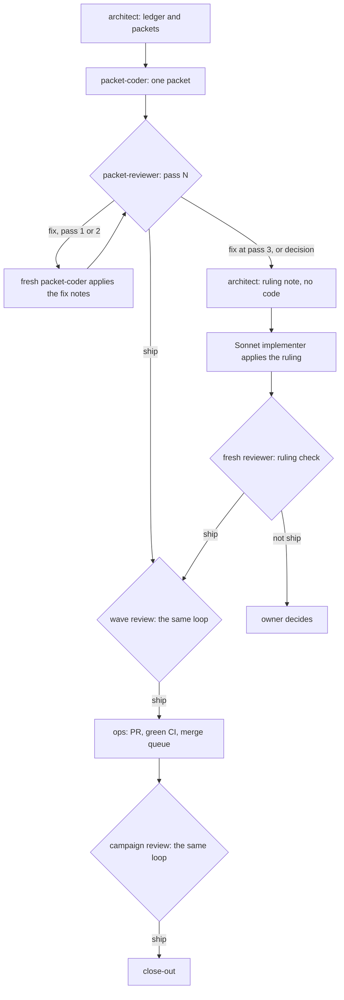
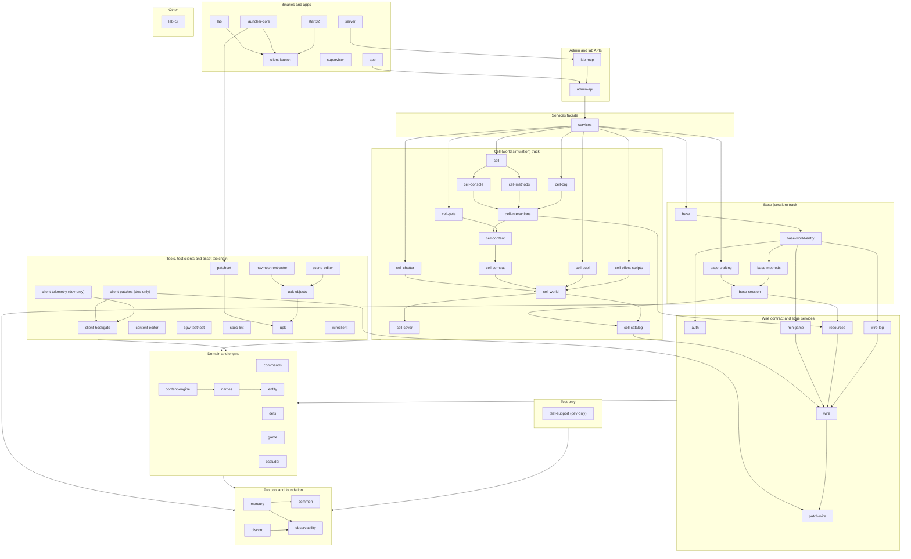

# Cimmeria — Stargate Worlds Server Emulator

[](https://github.com/SandboxServers/Cimmeria/actions/workflows/test.yml)
[](https://codecov.io/gh/SandboxServers/Cimmeria)

A server emulator for [Stargate Worlds](https://en.wikipedia.org/wiki/Stargate_Worlds), the cancelled Stargate MMO developed by Cheyenne Mountain Entertainment. The game was built on [BigWorld Technology](https://en.wikipedia.org/wiki/BigWorld) (networking/server) and Unreal Engine 3 (rendering/client), and reached a playable beta before the studio shut down in 2010.

Cimmeria reimplements the server infrastructure — authentication, world simulation, entity management, and game logic — allowing the original game client to connect and play.

## Status

The project tracks **<!-- gen:gap-count total -->512<!-- /gen:gap-count --> features** across <!-- gen:gap-systems -->45<!-- /gen:gap-systems --> systems against the Rust codebase. **<!-- gen:gap-pct CW+NT+IM 0 -->81%<!-- /gen:gap-pct --> have code** (<!-- gen:gap-count CW+NT+IM -->415<!-- /gen:gap-count --> of <!-- gen:gap-count total -->512<!-- /gen:gap-count -->); **<!-- gen:gap-pct CW 0 -->33%<!-- /gen:gap-pct --> are confirmed working** end-to-end with the live client (<!-- gen:gap-count CW -->167<!-- /gen:gap-count --> of <!-- gen:gap-count total -->512<!-- /gen:gap-count -->), and another <!-- gen:gap-count NT -->146<!-- /gen:gap-count --> are merged and waiting for a client test. These figures are generated from the gap analysis's summary matrix. See the [Gap Analysis](docs/gap-analysis.md) for the full per-system breakdown.

**Tested end-to-end with the game client:**
- Login and authentication (HTTP SOAP → shard select → Mercury UDP)
- Mercury reliable UDP transport with AES-256 encryption, per-channel fragment reassembly
- Game data pipeline (21 resource categories, 112,626 DB rows)
- Character creation and world entry, entity spawning, grid-based Area of Interest
- Castle Cellblock and Castle played end to end (2026-09-18 colo playtest): missions, dialogs, NPC combat, loot, ring transport, the Livewire minigame
- Contact lists and the GM command console
- Durable Base→Cell content event delivery via persistent outbox
- One-command build and setup

**Code exists, needs verification:**
Vendors | Chat | Trading | NPC AI restoration (September) | Stargate DHD and multi-player gate sync | Harset

**Implemented with known gaps:**
Combat & abilities | Effects | Missions (no cash or item rewards yet) | Spawn population control | Mail (read only) | Stats & leveling | Crafting (state only)

See [docs/project-status.md](docs/project-status.md) for the detailed breakdown.

## Download the launcher

Players download the launcher from a stable link, which always holds the
newest release:

- **Windows:** [`StargateWorlds-Launcher-windows-x64.zip`](https://github.com/SandboxServers/Cimmeria/releases/download/launcher-current/StargateWorlds-Launcher-windows-x64.zip).
  Unzip it into a folder of its own and run `cimmeria-launcher-desktop.exe`,
  keeping the `windows` and `graphics` folders beside it. It updates itself
  from Settings.
- **macOS (Apple silicon):** [`StargateWorlds-Launcher-macos-arm64.zip`](https://github.com/SandboxServers/Cimmeria/releases/download/launcher-current/StargateWorlds-Launcher-macos-arm64.zip).
  See [Playing on a Mac](docs/guides/macos.md).

The old `sgw-launcher.exe` was retired and no longer updates itself; the new
launcher can import its settings and adopt the game it installed. See the
[launcher guide](docs/client/launcher-guide.md).

## Tests & CI

The Rust workspace currently carries **<!-- gen:tests-total -->14,729<!-- /gen:tests-total --> `#[test]` / `#[tokio::test]` cases** across **<!-- gen:tests-files -->2,417<!-- /gen:tests-files --> files**, of which **<!-- gen:tests-ci-gated -->12,222<!-- /gen:tests-ci-gated --> are gated on every PR** (CI excludes the two Tauri editors, the Tauri app, the Windows-only client-telemetry and client-patches cdylibs, and the live research lab; the desktop launcher is a separate workspace with its own workflow). **<!-- gen:tests-live-db -->1,773<!-- /gen:tests-live-db --> are live-DB regression guards** (gated by `require_db_or_skip!`) and **3 are end-to-end PL/pgSQL smoke scripts** (vendor stack, inventory move, progression). GitHub Actions runs five gating jobs on every PR — `cargo fmt --check`, `cargo clippy -D warnings`, `cargo build`, `cargo nextest run` (workspace, no DB), and the live-DB tier (`tools/test-live-db.sh`: the lib tests of every crate with live-DB tests) against a `postgres:17.9` service container loaded from `db/database.sql`. nextest's JUnit output is uploaded to Codecov Test Analytics for per-test history and flake detection.

For the test-type taxonomy (unit / wire-format / live-DB / smoke / concurrency / chain-replay), when each is appropriate, common gotchas, and the patterns reviewers expect to see, read **[TESTING.md](TESTING.md)**.

## How AI development works here

Most of the code and docs in this repo are written by AI agents, under the direction of one human owner. This section explains how that works and why, for someone who has never seen it before. The deeper reference, with every file, count, format and number, is [How we build with AI](docs/agents/ai-sdlc.md). The harness settings, hooks and agent list are in [ai-harness.md](docs/agents/ai-harness.md).

Claude Code starts here as the `orchestrator` persona: it dispatches agents and has no shell, and the session banner says so. `claude --agent hands-on` starts a full-tool session instead. Codex users read [AGENTS.md](AGENTS.md).

### The short version

- A big change is a **campaign**: a folder of written decisions and work orders, so the work never depends on one long chat.
- The strongest model (Opus) **designs** the work and slices it into **packets**, small prescriptive work orders. It never writes the code.
- The cheapest model (Haiku) **implements** each packet in its own isolated copy of the repo. Packets are grouped into **waves**, and the packets of a wave run in parallel.
- A mid-tier model (Sonnet) **reviews** every packet without editing it, and writes numbered fix notes. A fresh Haiku session applies them. The review repeats at most 3 times; after that the designer rules on what to fix, and still writes no code.
- The same review runs again at each **wave boundary** and at the **end of the campaign**, for problems no single packet shows.
- **Guards** stop agents from running builds, reads and git the expensive or dangerous way. A **ship script** opens and merges every PR through a merge queue that needs green CI.
- A **human** makes every owner decision, approves every use of the live game client, and runs the final acceptance tests.

### Campaigns

A campaign is the unit for work too big for one pull request. It is a folder, `docs/analysis/<campaign>/`, that holds the goal, the findings with their evidence, the decisions with a reason for each, the work packets, a table with the status of every packet, and a `RESUME.md` card of at most 40 lines.

Why: a chat session forgets. When its context fills it is compacted, and whatever was not written down is gone. A session also costs more as it grows, because every request re-reads the whole context: in the three weeks to 2026-10-03, the median main-session request carried 349k tokens. And one chat does one thing at a time. A campaign writes the design down once, lets many cheap sessions work from it in parallel, and lets any fresh session pick the work up from `RESUME.md`.

A campaign starts when the orchestrator dispatches the `architect`, which researches, decides and writes the ledger and the packets. The waves then run one after another. A close-out packet ends it: it updates the status docs (once per campaign, never per packet), lists what the owner still has to test, and retires the worktrees.

### Packets and waves

A **packet** is a work order that a small model can follow without designing anything. It names the exact files and functions to change, the test to add and why that test fails when the change is reverted, the checks to run, the docs it owes, and the commit subject. It also carries the 5 to 10 repo rules it needs, because the coder does not load `CLAUDE.md`. The packet is the contract: the coder has nothing to decide, so the cheapest model can do the work, and the reviewer has something exact to check against.

A packet is sized to about 40k working tokens, because about 35-40k of every Haiku session is fixed overhead. In the campaign-metrics campaign, 9 of its first 34 Haiku sessions hit the 90k cap; after the re-slice, 0 of 36 did. Anything bigger is split: there is no medium size.

A **wave** is a group of about six packets. Its independent packets run in parallel, each in its own git worktree with its own test database, so two agents never race on one checkout. Six is what one reviewer can hold in one context at the wave review. A wave ships as one PR per packet or, when its packets must land together, as one PR from an integration branch.

### Who does what

| Agent | Model | Does | Cannot |
|---|---|---|---|
| `orchestrator` | Sonnet | the default persona: dispatches agents, asks the owner, keeps the ledger | run a shell, write outside the ledger folders, or read a long source file in one go |
| `architect` | Opus | researches, decides, writes the ledger, the packets and the rulings | write code |
| `packet-coder` | Haiku | implements one packet, or applies one review's fix notes; runs the checks; commits locally | push, open PRs, design, load `CLAUDE.md` |
| `packet-reviewer` | Sonnet | reviews a packet, a wave or the campaign, and writes numbered fix notes | edit anything |
| `ops` | Haiku | one git, worktree, PR, merge or board operation through the repo scripts | anything not on its list |
| `rust-gameserver-dev`, `documentation-writer` | Sonnet | the next step for a packet Haiku could not finish, and larger docs | - |
| domain advisors | Sonnet or Opus | read-only review of their subsystem (combat, movement, protocol, trust boundaries...) | - |
| `lab-driver` | Haiku | drives the live game client from an exact step list | diagnose, edit, build |
| `hands-on` | Opus | a full-tool session that a human starts with `claude --agent hands-on` | - (never dispatched for packets) |

Each agent is given only the tools its job needs, which narrows what it can do. The orchestrator has no shell, so it cannot slip into doing the work itself at its large context. The reviewer has no Edit or Write tool and is told never to edit; it does have a shell, so that part rests on its instructions, not on a block. `ops` runs only scripts that check their inputs. Each model does what it is best at: Haiku follows exact steps cheaply, Sonnet finds what is wrong, and Opus judges, at the highest price per token.

### Review loops



A wave of one packet skips the wave review. In the wave and campaign reviews a `fix` sends the notes to a fresh packet-coder, as in the packet loop.

Three loops run, all with the same shape. A **pass** is one fresh, read-only `packet-reviewer` session, and it returns `ship`, `fix` or `decision`. On `fix`, a fresh `packet-coder` applies the report's numbered fix notes exactly as written, reruns the packet's checks and commits, and a fresh reviewer checks again. A loop has at most 3 passes.

- **The packet loop** starts as soon as a packet's coder is done. It checks correctness, drift from the spec, tests that would still pass with the fix reverted, and the repo rules.
- **The wave loop** starts once every packet of a wave has `ship`. It looks only for what no single packet shows: two packets that describe one thing differently, the same helper written twice, two packets editing one file, and merge-order hazards.
- **The campaign loop** starts after the last wave merges. It looks for docs that no longer match behaviour, decisions with nothing behind them, broken links and stale generated blocks.

**When a loop runs out.** If pass 3 still says `fix`, or a pass says `decision`, the architect decides only what to fix and how, in a ruling note: re-spec, re-slice, accept with a follow-up packet, or ask the owner. The architect writes no code or fix. A Sonnet implementer applies the ruling, and one fresh reviewer checks it. If that check fails, the owner decides.

Why this shape: Haiku rarely lands a packet first time (only 4.8% of judged Haiku packets were accepted on the first pass: 6 of 125 judged; separately, 88 of 188 accepted pure-Haiku packets could not be judged, so this is a rate over reviewed packets), so review is a built-in step, not an exception. A reviewer that never edits stays adversarial on every pass, and the fixing runs on the cheapest model: in one campaign's own 20 packets, the Sonnet reviews cost $13.58 and the Haiku fix rounds $0.72. The fix notes go to a fresh session, not back to the one that wrote the code, because Haiku 5.5 bills 5x per request above a 100k prompt (from the profiler's price table, not re-checked against the price page).

### Guards, and what the evidence shows

Of the seven hooks below, four run at session start (three in Claude Code, one in Codex) and three run before tool calls. Only `shell_guard` and `orchestrator_guard` refuse anything. The rest of the protection comes from what each agent is allowed to run.

| Guard | What it stops | Evidence (the problem, not the saving) |
|---|---|---|
| `cargo` only through the build lane (`shell_guard`) | parallel builds racing on one target directory, and whole build logs in context | 326 direct calls in the profiled week from 2026-10-03; about 254 GB of build output on 2026-09-26 (171 GB in the main checkout's target directory, 62 GB in twelve worktree target directories, 21 GB of sccache; no after figure was measured); a 296-test summary fell from 36,765 to about 270 characters |
| Reads and searches through Read and Grep (`shell_guard`, Claude Code only) | whole files dumped through the shell | about 10,000 shell reads in the same week; `sed -n` alone returned 38.5M characters |
| No shell for the orchestrator (its tool list) | the coordinator doing hands-on work at full context | the Opus main session made 3,666 PowerShell calls at 354,545 tokens of average context; one Sonnet-orchestrator pilot averaged 75,159 over 58 requests, but its next wave averaged 122,503 and it missed two of its five targets (not a controlled comparison) |
| Git hygiene by brief and script, not by a hook | lost worktrees, and a push from the wrong checkout | about 22 worktree registrations vanished on 2026-10-03; the cause is not confirmed, and the two scripts that ran `git worktree prune` no longer do by default. Workers are told never to stash, push, prune or open PRs; `ship` refuses to commit or push outside a registered worktree on a feature branch. No hook blocks raw git. |

Only one saving is measured: the lane's 36,765 to about 270 characters, for one command. How much each refused call saves has not been measured.

The guards cost time: on one Windows machine, for one allowed command (`shell_guard`), a median of about 96 ms per shell call (30 runs; total hook time in a real session has not been measured), about 1.6 minutes per 1,000 calls ([hook-timing.md](docs/analysis/ai-harness-docs/hook-timing.md)). The full guard list and its numbers are in [ai-sdlc.md § Guards in detail](docs/agents/ai-sdlc.md#guards-in-detail).

### Shipping

`ops` ships every PR with two script calls. `ship.ps1 pr` commits, pushes once and opens the PR. `ship.ps1 merge --retire` puts it in `main`'s merge queue, which runs the full build and tests on the merged code and needs green CI, and then retires the worktree. Code merges stop while `main` is red; docs-only PRs still merge. Every PR also gets an adversarial review by an agent that did not write it.

### When a human decides

Agents never ask the owner on their own. The architect marks the owner's calls as `BlockedDecision` in the ledger, and the orchestrator asks. The owner decides:

- every `BlockedDecision`;
- every use of the live lab client;
- anything destructive: deleting data, force operations, wiping a database;
- client patches, new opcodes, wire crypto and client UI;
- a change to an agent persona or to the process itself;
- the final acceptance tests that need a human at the keyboard.

### What it costs

| Measure | Opus implements (before 2026-10-10) | Haiku packets, Sonnet review |
|---|---|---|
| Cost per 1,000 changed lines | $7.44 | $3.03 (2.5x cheaper) |
| Cost per accepted change | $18.65 | $2.35 |
| Cost per merged PR, mean / median | $22.01 / $18.18 (248 PRs, $5,727.50) | $2.67 / $0.91 (185 PRs, $594.06) |
| Spend by tier | Opus 93% | Opus 75%, Sonnet 22%, Haiku 2% |

Source: [campaign-metrics findings](docs/analysis/campaign-metrics/findings.md). The work differs: Haiku campaigns implement from a finished spec, and the cost of writing that spec sits in the Opus coordinator. So the fair comparison is the 2.5x per 1,000 changed lines, not the per-PR figures. When Opus wrote code itself, the oversteps cost $107.43, of which $53.72 to $84.20 was recoverable at the intended tier. What the review loop costs against the combined reviewer-and-fixer it replaced has not been measured yet; [ai-sdlc.md § Honest numbers](docs/agents/ai-sdlc.md#honest-numbers) lists everything else that is not measured.

**Hooks:** every hook the harness runs, with its event, matcher, script and reason, is listed below; the bypasses are in [ai-harness.md](docs/agents/ai-harness.md#hooks-and-guards).

<!-- gen:harness-hooks -->


| Event | Matcher | Configured in | Runs | Why |
|---|---|---|---|---|
| SessionStart | (all) | `.claude/settings.json` | `mode_banner.sh` | SessionStart mode banner: tells the user and the model which persona this session runs as. |
| SessionStart | (all) | `.claude/settings.json` | `agent-board` | Agent board: registers the session and shows unread board activity. External tool, skipped when it is not installed. |
| SessionStart | compact | `.claude/settings.json` | `resume_card.py` | SessionStart hook for the "compact" matcher: re-reads the active campaign. |
| PreToolUse | Bash\|PowerShell | `.claude/settings.json` | `shell_guard.py` | PreToolUse guard for shell tool calls (Bash and PowerShell). |
| PreToolUse | Edit\|Write\|Read | `agent: orchestrator` | `orchestrator_guard.py` | PreToolUse guard for the orchestrator persona (Edit, Write and Read). |
| SessionStart | (all) | `.codex/hooks.json` | `agent-board` | Agent board: registers the session and shows unread board activity. External tool, skipped when it is not installed. |
| PreToolUse | Bash | `.codex/hooks.json` | `shell_guard.py` | PreToolUse guard for shell tool calls (Bash and PowerShell). |


<!-- /gen:harness-hooks -->

**Everything else:**

- Every rule, count, format and number behind this section: [How we build with AI](docs/agents/ai-sdlc.md).
- Settings, agents, skills, board, memory and review bots: [ai-harness.md](docs/agents/ai-harness.md). The workflow and roster: [development-workflow.md](docs/agents/development-workflow.md).
- The campaign cycle: the [campaign-packet skill](.claude/skills/campaign-packet/SKILL.md). Codex: [AGENTS.md](AGENTS.md).

**Platform:** Windows with PowerShell 7 is fully supported; WSL, Linux, and Git Bash on Windows are not validated, but not unsupported. On Linux and WSL, agents use Bash and the `.sh` twins ([details](docs/agents/development-workflow.md#wsl-and-linux-hosts)).

## Quick Start

```bash
cargo run -p cimmeria-server
```

Handles login, Mercury protocol, character select, and world entry. Connect the game client to `localhost`.

**Test account:** `test` / `test`

### Run from a pre-built container (no Rust toolchain required)

A self-contained pre-release image with the server, cooked game data, and a pre-loaded Postgres is published to GHCR on demand — comment `/release` on a merged PR (or run the workflow manually) and the build at `main` HEAD ships. Versioned `YYYY-MM-DD.N` (UTC). See [docs/operations/container.md](docs/operations/container.md) for the release model.

```bash
docker run -d --name cimmeria \
  -p 13001:13001 -p 32832:32832/udp -p 50000:50000/udp \
  -p 8081:8081 -p 8443:8443 \
  -e BASE_EXTERNAL=<your-LAN-or-WAN-ip> \
  -v cimmeria-data:/var/lib/postgresql/data \
  ghcr.io/sandboxservers/cimmeria-server:latest-prerelease
```

`BASE_EXTERNAL` defaults to `127.0.0.1` and must be overridden for any client not on the host. See [docs/operations/container.md](docs/operations/container.md) for the full env reference, volume layout, and reset workflow.

## Architecture

```
                          ┌─────────────────┐
                          │   Game Client    │
                          │  (UE3 + BigWorld)│
                          └────────┬────────┘
                                   │
                    ┌──────────────┼──────────────┐
                    │              │               │
              HTTP :8081    Mercury UDP      Mercury UDP
                    │         :32832              :?
                    ▼              ▼               ▼
            ┌──────────┐   ┌──────────┐    ┌──────────┐
            │   Auth   │──▶│ BaseApp  │───▶│ CellApp  │
            │  Server  │   │          │    │          │
            └──────────┘   └──────────┘    └──────────┘
            Login, accounts  Entities,      World cells,
            Shard auth       persistence    movement, AoI
```

- **AuthenticationServer** — HTTP/SOAP login, account management, shard key exchange
- **BaseApp** — Persistent entity state, player data, character management
- **CellApp** — Spatial simulation, world cells, movement, Area of Interest
- **NavBuilder** — Offline navigation mesh generation (Recast/Detour)

## Crate Dependency Graph

The workspace crates and their **actual** inter-crate dependencies. An arrow
**A → B** means *crate A depends on crate B*. The diagram is generated from
`cargo metadata` and CI checks that it is current, so it always matches the
`Cargo.toml` files; GitHub renders the Mermaid below.

<!-- crate-graph:begin -->



*Generated by `tools/crate-graph/crate_graph.py` from `cargo metadata`: 60 workspace crates, 238 direct dependency edges (57 drawn crate to crate, after omitting edges already implied by a longer path; edges into the shared "Domain and engine" and "Protocol and foundation" layers are drawn as 6 layer-to-layer arrows). Dev-dependencies are not drawn. The `regen-docs` workflow regenerates this block on `main` every six hours (`python tools/docs-gen/regen.py`); `crate_graph.py --full` draws every edge.*

<!-- crate-graph:end -->

Every node is a workspace crate and the graph is a DAG rooted at **common** (the
shared types, config and error layer).

- **mercury** (reliable UDP, AES-256), **commands** (command and permission
  model), **entity** (live game objects), **game** and **content-engine** (the
  data-driven content pipeline) are the domain layer.
- **services** ties Auth, Base and Cell together. The **server** binary, the
  **admin-api** REST layer, **lab-mcp**, the **app** desktop GUI (repo-root
  `src-tauri/`, package `cimmeria-app`) and the headless **wireclient** test
  client build on it.
- **services has been split** into about 19 crates along its real seams: a
  wire contract (**wire**, **wire-log**), the edge services (**auth**,
  **resources**, **minigame**), a cell track (**cell-catalog**, **cell-cover** →
  **cell-world** → **cell-combat** → **cell-content** → **cell-interactions** →
  **cell-methods** / **cell-console** → **cell**) and a base track
  (**base-session** → **base-methods** → **base-world-entry** → **base**) that
  compile in parallel, with `cimmeria-services` left as a thin facade that
  re-exports each at its old paths. The plan, the target graph and each wave's
  status are in
  [docs/architecture/services-crate-split.md](docs/architecture/services-crate-split.md).
- **discord** (notifications) and **observability** (OTLP metrics) are
  cross-cutting libraries.
- The **upk** / **upk-objects** / **navmesh-extractor** / **occluder** crates
  plus the `scene-editor` tool form the Unreal-package, navmesh and
  line-of-sight toolchain.
- **test-support** is a dev-only crate shared by tests.

## Project Structure

```
Cimmeria/
├── crates/                 Rust server (active development — 19 crates)
│   ├── common/             Shared types, config, error handling
│   ├── mercury/            Mercury reliable UDP + AES-256 encryption
│   ├── defs/               Entity definition parser (XML → Rust types)
│   ├── entity/             Entity system (lifecycle, properties)
│   ├── commands/           Server command framework
│   ├── game/               Game mechanics and rules
│   ├── content-engine/     Data-driven content pipeline
│   ├── services/           Facade: orchestrator, DB pool, re-exports of the split service crates
│   ├── auth/               Auth service: SOAP login, TLS, credentials, login audit
│   ├── resources/          Cooked-data PAK cache, Cimmeria's overrides, CharDef table
│   ├── test-support/       Test helpers (live-DB gate, log capture); dev-only
│   ├── admin-api/          REST administration API
│   ├── supervisor/         Process supervision and service lifecycle
│   ├── server/             Binary entry point (cargo run -p cimmeria-server)
│   ├── discord/            Discord notification dispatch
│   ├── observability/      Metrics facade over the OpenTelemetry SDK
│   ├── wireclient/         Headless test client (Tier 3)
│   ├── upk/                UPK (Unreal Package) file parser
│   ├── upk-objects/        UPK object type definitions
│   ├── navmesh-extractor/  UE3 .umap geometry → .obj for NavBuilder
│   ├── occluder/           Collision-geometry occluders for server-side line of sight
│   ├── launcher/desktop/   Desktop launcher (Tauri + Effect), its own workspace
│   ├── launcher-core/      Shared installer, manifest and telemetry code for the launcher
│   └── client-telemetry/   Windows-only cdylib injected into SGW.exe
├── src-tauri/              Tauri desktop GUI wrapping the server (cimmeria-app)
├── entities/               XML entity definitions and type registry
├── data/                   Cooked game data (.pak) and navmeshes
├── db/                     PostgreSQL schemas
│   ├── database.sql        Database and role setup
│   ├── sgw/                Game schema (accounts, characters, items)
│   └── resources/          Resource data (abilities, effects, archetypes — 18 game systems)
├── docs/                   ~280 documents
├── tools/                  Editor tools, RE utilities, and live-DB smoke SQL scripts (vendor_store_smoke.sql, inventory_move_smoke.sql, progression_smoke.sql)
└── deprecated/             Retired C++/Python/MSVC sources kept for reference
```

## Tech Stack

| Crate | Purpose |
|---|---|
| `cimmeria-mercury` | Mercury reliable UDP, AES-256-CBC + HMAC-MD5 |
| `cimmeria-services` | Auth, Base, Cell service orchestration |
| `cimmeria-resources` | Cooked-data PAK cache and Cimmeria's in-memory overrides |
| `cimmeria-auth` | SOAP login handshake, auth TLS, credential storage, login audit |
| `cimmeria-cell-cover` | NPC cover: world-space cover loader, spatial index, slot reservation, scoring |
| `cimmeria-defs` | Entity definition parsing from XML |
| `cimmeria-content-engine` | Data-driven mission/effect/dialog runtime |
| `cimmeria-discord` | Discord notification dispatch (server + colo events) |
| `cimmeria-observability` | Metrics facade over the OpenTelemetry SDK (OTLP) |
| `cimmeria-wireclient` | Headless test client: SOAP auth, Mercury phase-3 handshake builders and a JSONL trace loader (no UDP socket or replay engine yet) |
| `tokio` | Async runtime and networking |
| `axum` | HTTP/REST for auth and admin API |
| `sqlx` | PostgreSQL async driver |
| `quick-xml` | SOAP/XML parsing |

## Database

PostgreSQL 17.9 schemas in `db/`:
- `db/database.sql` — Database and role setup (port 5433, role `w-testing`)
- `db/sgw/` — Game schema (accounts, characters, items, missions)
- `db/resources/` — Resource data (abilities, effects, loot, archetypes)

Test account: **test** / **test** (SHA1 hashed).

## Documentation

[docs/](docs/readme.md) contains **~270 documents** covering protocol, gameplay, engine internals, architecture, and reverse engineering.

**New here? Start with:**

- [Getting Started](docs/guides/getting-started.md) — first-time setup tutorial (prerequisites → `setup.ps1` → connecting the client → running tests)
- [Building the Server](docs/building.md) — how-to for cargo builds, the test suite, and CI checks
- [Troubleshooting](docs/troubleshooting.md) — common first-day problems and fixes
- [Live Research Lab setup](docs/guides/lab-contributor-setup.md) — let your Claude Code or Codex agent drive your own game client against a local server

**Understand the codebase:**

- [How SGW Works](docs/how-sgw-works.md) — BigWorld + UE3 hybrid architecture
- [Connection Flow](docs/connection-flow.md) — End-to-end login and world entry
- [Game Systems](docs/game-systems.md) — Combat, abilities, stargates, missions, crafting
- [Service Architecture](docs/architecture/service-architecture.md) — Auth / Base / Cell topology

**Plan and contribute:**

- [Project Status](docs/project-status.md) — What works and what's left
- [Gap Analysis](docs/gap-analysis.md) — Per-feature completion tracking
- [Contributing](CONTRIBUTING.md) — Contribution scope, code style, PR conventions
- [Testing Guide](TESTING.md) — Test types, when to use which, common gotchas

**Operate and deploy:**

- [Container Distribution](docs/operations/container.md) — `docker run` the published GHCR image, env reference, release model
- [Integration Test Infra](docs/architecture/integration-test-infra.md) — Live-DB test setup and rationale

For reverse engineering: [docs/reverse-engineering/](docs/reverse-engineering/PLAN.md)

## Contributing

Contributions welcome. See **[CONTRIBUTING.md](CONTRIBUTING.md)** for scope, code style, PR conventions, and where to find a first issue. The pre-PR checklist lives in [docs/agents/pre-pr-checks.md](docs/agents/pre-pr-checks.md); test conventions in [TESTING.md](TESTING.md). Project conduct expectations are in [CODE_OF_CONDUCT.md](CODE_OF_CONDUCT.md).

## Security

If you find a security issue, **please do not open a public issue**. See [SECURITY.md](SECURITY.md) for the private reporting path.

## License

This project is a server emulator for research and preservation purposes. A formal license file is pending — until it lands, treat the source as available for reading, building, and contributing back, but ask before redistributing.
