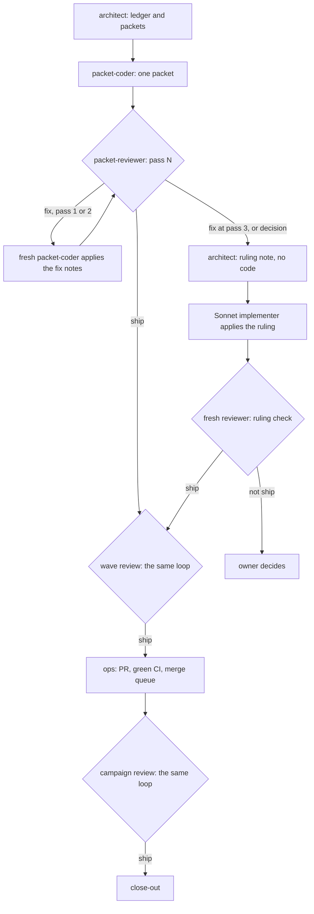

# ai-harness-docs: wave 4b verbatim drafts

The packets AH-23a and AH-23b in [work-packets-w4b.md](work-packets-w4b.md) copy these blocks into the target files with the C16b splice and extraction commands. These blocks replace the `readme-ai-a`, `readme-ai-b` and `ai-sdlc` blocks that were in [w4-drafts.md](w4-drafts.md) before the owner's answers of 2026-10-18 (D-AH50). The rules are those of w4-drafts.md:

- The text between `<!-- BEGIN <name> -->` and `<!-- END <name> -->` is copied exactly, with no edits. The marker lines themselves are not copied.
- Links inside a block are relative to the **target** file, not to this file. They resolve once the target is written, not here.
- No block contains a generated-block marker, so `tools/docs-gen/regen.py` never treats this file as a generator target.
- The splice command writes the block with the target file's own line endings.

Blocks: `readme-ai-a` and `readme-ai-b` (AH-23a, the README section: the newcomer explanation), `ai-sdlc` (AH-23b, `docs/agents/ai-sdlc.md`: the deeper reference). The README section explains; ai-sdlc.md holds the detail, and no paragraph appears in both.

<!-- BEGIN readme-ai-a -->
## How AI development works here

Most of the code and docs in this repo are written by AI agents, under the direction of one human owner. This section explains how that works and why, for someone who has never seen it before. The deeper reference, with every file, count, format and number, is [How we build with AI](docs/agents/ai-sdlc.md). The harness settings, hooks and agent list are in [ai-harness.md](docs/agents/ai-harness.md).

Claude Code starts here as the `orchestrator` persona: it dispatches agents and has no shell, and the session banner says so. `claude --agent hands-on` starts a full-tool session instead. Codex users read [AGENTS.md](AGENTS.md).

### The short version

- A big change is a **campaign**: a folder of written decisions and work orders, so the work never depends on one long chat.
- The strongest model (Opus) **designs** the work and slices it into **packets**, small prescriptive work orders. It never writes the code.
- The cheapest model (Haiku) **implements** each packet in its own isolated copy of the repo. Packets are grouped into **waves**, and the packets of a wave run in parallel.
- A mid-tier model (Sonnet) **reviews** every packet without editing it, and writes numbered fix notes. A fresh Haiku session applies them. The review repeats at most 3 times; after that the designer rules on what to fix, and still writes no code.
- The same review runs again at each **wave boundary** and at the **end of the campaign**, for problems no single packet shows.
- **Guards** stop agents from running builds, reads and git the expensive or dangerous way. A **ship script** opens and merges every PR through a merge queue that needs green CI.
- A **human** makes every owner decision, approves every use of the live game client, and runs the final acceptance tests.

### Campaigns

A campaign is the unit for work too big for one pull request. It is a folder, `docs/analysis/<campaign>/`, that holds the goal, the findings with their evidence, the decisions with a reason for each, the work packets, a table with the status of every packet, and a `RESUME.md` card of at most 40 lines.

Why: a chat session forgets. When its context fills it is compacted, and whatever was not written down is gone. A session also costs more as it grows, because every request re-reads the whole context: in the three weeks to 2026-10-03, the median main-session request carried 349k tokens. And one chat does one thing at a time. A campaign writes the design down once, lets many cheap sessions work from it in parallel, and lets any fresh session pick the work up from `RESUME.md`.

A campaign starts when the orchestrator dispatches the `architect`, which researches, decides and writes the ledger and the packets. The waves then run one after another. A close-out packet ends it: it updates the status docs (once per campaign, never per packet), lists what the owner still has to test, and retires the worktrees.

### Packets and waves

A **packet** is a work order that a small model can follow without designing anything. It names the exact files and functions to change, the test to add and why that test fails when the change is reverted, the checks to run, the docs it owes, and the commit subject. It also carries the 5 to 10 repo rules it needs, because the coder does not load `CLAUDE.md`. The packet is the contract: the coder has nothing to decide, so the cheapest model can do the work, and the reviewer has something exact to check against.

A packet is sized to about 40k working tokens, because about 35-40k of every Haiku session is fixed overhead. Before packets were cut to that size, 9 of 34 Haiku sessions hit their 90k cap; afterwards, 0 of 36 did. Anything bigger is split: there is no medium size.

A **wave** is a group of about six packets. Its independent packets run in parallel, each in its own git worktree with its own test database, so two agents never race on one checkout. Six is what one reviewer can hold in one context at the wave review. A wave ships as one PR per packet or, when its packets must land together, as one PR from an integration branch.

### Who does what

| Agent | Model | Does | Cannot |
|---|---|---|---|
| `orchestrator` | Sonnet | the default persona: dispatches agents, asks the owner, keeps the ledger | run a shell, read source, write code |
| `architect` | Opus | researches, decides, writes the ledger, the packets and the rulings | write code |
| `packet-coder` | Haiku | implements one packet, or applies one review's fix notes; runs the checks; commits locally | push, open PRs, design, load `CLAUDE.md` |
| `packet-reviewer` | Sonnet | reviews a packet, a wave or the campaign, and writes numbered fix notes | edit anything |
| `ops` | Haiku | one git, worktree, PR, merge or board operation through the repo scripts | anything not on its list |
| `rust-gameserver-dev`, `documentation-writer` | Sonnet | the next step for a packet Haiku could not finish, and larger docs | - |
| domain advisors | Sonnet or Opus | read-only review of their subsystem (combat, movement, protocol, trust boundaries...) | - |
| `lab-driver` | Haiku | drives the live game client from an exact step list | diagnose, edit, build |
| `hands-on` | Opus | a full-tool session that a human starts with `claude --agent hands-on` | - (never dispatched for packets) |

Each agent has only the tools its job needs, because an agent cannot misuse a tool it does not have. The orchestrator has no shell, so it cannot slip into doing the work itself at its large context. The reviewer has no Edit tool, so it cannot fix something and then approve its own fix. `ops` runs only scripts that check their inputs. Each model does what it is best at: Haiku follows exact steps cheaply, Sonnet finds what is wrong, and Opus judges, at the highest price per token.

### Review loops

Three loops run, all with the same shape. A **pass** is one fresh, read-only `packet-reviewer` session, and it returns `ship`, `fix` or `decision`. On `fix`, a fresh `packet-coder` applies the report's numbered fix notes exactly as written, reruns the packet's checks and commits, and a fresh reviewer checks again. A loop has at most 3 passes.

- **The packet loop** starts as soon as a packet's coder is done. It checks correctness, drift from the spec, tests that would still pass with the fix reverted, and the repo rules.
- **The wave loop** starts once every packet of a wave has `ship`. It looks only for what no single packet shows: two packets that describe one thing differently, the same helper written twice, two packets editing one file, and merge-order hazards.
- **The campaign loop** starts after the last wave merges. It looks for docs that no longer match behaviour, decisions with nothing behind them, broken links and stale generated blocks.

**When a loop runs out.** If pass 3 still says `fix`, or a pass says `decision`, the architect decides only what to fix and how, in a ruling note: re-spec, re-slice, accept with a follow-up packet, or ask the owner. The architect writes no code or fix. A Sonnet implementer applies the ruling, and one fresh reviewer checks it. If that check fails, the owner decides.

Why this shape: Haiku rarely lands a packet first time (only 4.8% of judged Haiku packets were accepted on the first pass), so review is a built-in step, not an exception. A reviewer that never edits stays adversarial on every pass, and the fixing runs on the cheapest model: in one campaign's own 20 packets, the Sonnet reviews cost $13.58 and the Haiku fix rounds $0.72. The fix notes go to a fresh session, not back to the one that wrote the code, because Haiku 5.5 bills 5x per request above a 100k prompt.

### Guards, and what they save

Hooks run before tool calls, and two of them refuse calls. The rest of the protection comes from what each agent is allowed to run.

| Guard | What it stops | Evidence |
|---|---|---|
| `cargo` only through the build lane (`shell_guard`) | parallel builds racing on one target directory, and whole build logs in context | 326 direct calls in the profiled week from 2026-10-03; about 254 GB of build output before the lane; a 296-test summary fell from 36,765 to about 270 characters |
| Reads and searches through Read and Grep (`shell_guard`, Claude Code only) | whole files dumped through the shell | about 10,000 shell reads in the same week; `sed -n` alone returned 38.5M characters |
| No shell for the orchestrator (its tool list) | the coordinator doing hands-on work at full context | the Opus main session made 3,666 PowerShell calls at 354,545 tokens of average context; one pilot of the Sonnet orchestrator averaged 75,159 |
| `git` only through `ops` and its scripts (tool lists, not a hook) | lost worktrees, and pushes from the wrong checkout | about 22 worktree registrations lost on 2026-10-03 |

The guards cost time: `shell_guard` takes a median 95.8 ms per shell call, about 1.6 minutes per 1,000 calls ([hook-timing.md](docs/analysis/ai-harness-docs/hook-timing.md)). How much each refused call saves has not been measured. The full guard list and its numbers are in [ai-sdlc.md § Guards in detail](docs/agents/ai-sdlc.md#guards-in-detail).

### Shipping

`ops` ships every PR with two script calls. `ship.ps1 pr` commits, pushes once and opens the PR. `ship.ps1 merge --retire` puts it in `main`'s merge queue, which runs the full build and tests on the merged code and needs green CI, and then retires the worktree. Nothing merges while `main` is red. Every PR also gets an adversarial review by an agent that did not write it.

### When a human decides

Agents never ask the owner on their own. The architect marks the owner's calls as `BlockedDecision` in the ledger, and the orchestrator asks. The owner decides:

- every `BlockedDecision`;
- every use of the live lab client;
- anything destructive: deleting data, force operations, wiping a database;
- client patches, new opcodes, wire crypto and client UI;
- a change to an agent persona or to the process itself;
- the final acceptance tests that need a human at the keyboard.

### What it costs

| Measure | Opus implements (before 2026-10-10) | Haiku packets, Sonnet review |
|---|---|---|
| Cost per 1,000 changed lines | $7.44 | $3.03 (2.5x cheaper) |
| Cost per accepted change | $18.65 | $2.35 |
| Cost per merged PR, mean / median | $22.01 / $18.18 (248 PRs, $5,727.50) | $2.67 / $0.91 (185 PRs, $594.06) |
| Spend by tier | Opus 93% | Opus 75%, Sonnet 22%, Haiku 2% |

Source: [campaign-metrics findings](docs/analysis/campaign-metrics/findings.md). The work differs: Haiku campaigns implement from a finished spec, and the cost of writing that spec sits in the Opus coordinator. So the fair comparison is the 2.5x per 1,000 changed lines, not the per-PR figures. When Opus wrote code itself, the oversteps cost $107.43, of which $53.72 to $84.20 was recoverable at the intended tier. What the review loop costs against the combined reviewer-and-fixer it replaced has not been measured yet; [ai-sdlc.md § Honest numbers](docs/agents/ai-sdlc.md#honest-numbers) lists everything else that is not measured.

**Hooks:** every hook the harness runs, with its event, matcher, script and reason, is listed below; the bypasses are in [ai-harness.md](docs/agents/ai-harness.md#hooks-and-guards).
<!-- END readme-ai-a -->

<!-- BEGIN readme-ai-b -->
**Everything else:**

- Every rule, count, format and number behind this section: [How we build with AI](docs/agents/ai-sdlc.md).
- Settings, agents, skills, board, memory and review bots: [ai-harness.md](docs/agents/ai-harness.md). The workflow and roster: [development-workflow.md](docs/agents/development-workflow.md).
- The campaign cycle: the [campaign-packet skill](.claude/skills/campaign-packet/SKILL.md). Codex: [AGENTS.md](AGENTS.md).
<!-- END readme-ai-b -->

<!-- BEGIN ai-sdlc -->
# How we build with AI

> **Last updated**: YYYY-MM-DD
> **Audience**: Anyone who has read the README's AI section and wants the detail behind it
> **Type**: Reference

The [README section](../../README.md#how-ai-development-works-here) explains, for someone new to all of it, how this repo's AI-driven development works and why. This page is the reference behind it: the files a campaign keeps, what a packet contains, the formats, the counts and limits, the full guard list and every number, with its source and with what has not been measured. The exact rules the agents follow are in the [campaign-packet skill](../../.claude/skills/campaign-packet/SKILL.md), [development-workflow.md](development-workflow.md) and [rules-and-gotchas.md](rules-and-gotchas.md); the harness settings, hooks and the generated agent list are in [ai-harness.md](ai-harness.md).

## Campaign files

A campaign lives in `docs/analysis/<campaign>/`:

| File | Holds |
|---|---|
| `README.md` | the purpose, the findings (with evidence), the decisions (`D-XX1`, with a reason each), and a packet table with a status per packet |
| `work-packets*.md` | the shared contract the packets build against, then one section per packet, grouped into waves |
| `RESUME.md` | a resume card of at most 40 lines: the current wave, what is in flight, the next action, the open decisions |
| `worknotes/<packet>.md` | what a stopped session finished and what it left, and any ruling note, so the next session starts from a file, not a transcript |

A packet's status is one of Ready, BlockedDependency, BlockedDecision, Writing, Review, Integrated, UATPending or Done.

In Claude Code, a hook (`resume_card.py`) injects the first 40 lines of the active campaign's `RESUME.md` after every compaction. That is why the card has a 40-line cap: a longer card loses its tail. The orchestrator's context limit is 200k tokens.

The close-out packet updates `docs/project-status.md` and the gap analysis once per campaign, adds the steps the owner still has to run to [unified-uat.md](../guides/unified-uat.md), retires the worktrees, and posts a handoff to the agent board.

## What a packet contains

- the exact files and functions to change, with code shapes for anything non-obvious;
- the test to add, its type per [TESTING.md](../../TESTING.md), and why it fails when the change is reverted;
- the checks to run, in order, through the build lane (`fmt`, then `clippy`, then tests, each `-p` the crate);
- the docs rows it owes ([doc-update-map.md](doc-update-map.md));
- the branch, the worktree name and the commit subject;
- the 5 to 10 repo rules it needs (the lane command, the test type, the file caps, CRLF docs, no `git stash`).

Design-heavy, reverse-engineering or larger docs packets go to a defined Sonnet or Opus agent with the same brief shape, not to `packet-coder`. The size numbers come from [campaign-metrics](../analysis/campaign-metrics/findings.md).

## Agents, tools and models

The generated agent table, with each agent's model and description, is in [ai-harness.md](ai-harness.md). What the tool sets enforce:

- `orchestrator`: Agent, AskUserQuestion, TaskStop, Read, Glob, Edit and Write, with no shell. Its `orchestrator_guard` limits Edit and Write to the ledger folders.
- `packet-coder`: Read, Edit, Write, Grep, Glob and a shell. It skips `CLAUDE.md`, which is why each packet carries its own rules.
- `packet-reviewer`: Read, Grep, Glob and a shell, with no Edit or Write, so it cannot change what it reviews.
- `ops`: a shell and Read, and an allowed list of repo scripts; anything else is refused as `blocked`.
- `lab-driver`: only the lab's MCP tools.

The model numbers behind the roles: 16.9% of Haiku-regime packets escalated (44 of 261), and each accepted packet needed 0.60 retries. Sonnet is the next step for a packet Haiku cannot finish. Opus oversteps (coding, implementing a Haiku packet, or researching in the main session) cost $107.43, of which $53.72 to $84.20 would have been recoverable at the intended tier.

## One worktree, one database

Every agent that writes gets its own git worktree under `.claude/worktrees/<name>/`, made by `mk-worktree.ps1`, and its own test database, `sgw_<name>`. Two writers in one checkout race on git state: one agent's checkout reverts the other's edits. Read-only agents need no worktree.

A worktree is retired the day its PR merges, through `ship.ps1 merge --retire` or `rm-worktree.ps1`. Merged worktrees left behind are not harmless: on 2026-09-26 their build output filled the build drive and stopped every lane build (the build output once reached about 254 GB, [build-system.md](../architecture/build-system.md)). Nobody runs `git worktree prune`: on 2026-10-03 the registrations of about 22 worktrees vanished while their folders stayed, and a worker whose worktree was gone pushed from the main checkout ([rules-and-gotchas.md](rules-and-gotchas.md#windows-and-tooling-traps)).

## Reports and one-line returns

A worker writes its full report to a file inside its own worktree, `<worktree>\.claude\reports\<campaign>\<packet>-<role>.md`, and returns exactly one line to the orchestrator: `<packet> <done|blocked|failed> <commit-sha|-> <report-path>`. A reviewer's line is `<packet-or-scope> done <reviewed-head-sha> <report-path> verdict=<ship|fix|decision>`; at wave scope it ends `verdicts=<packet>:<verdict>,...`.

The orchestrator updates the ledger from that line and opens the report only on `blocked`, `failed` or `decision`. Everything the orchestrator reads stays in its context and is paid for again on every later request, so a report it does not need to read is a report it should not read. A `fix` verdict needs no reading either: the orchestrator passes the report's path to the next coder.

## When a session runs out of context

- **A packet-coder** has a 95k-token limit and stops at about 90k. It commits only work whose checks pass (subject suffix `(part N)`), writes `worknotes/<packet>.md`, and returns `blocked` with the reason `context`. A fresh packet-coder continues from the worknote ("continuation N of 3"). After 3 sessions, one Sonnet implementer takes over; if that fails too, the architect re-slices the packet.
- **Other workers** hand off at about 200 requests or about 250k tokens of context, the same way.
- **The orchestrator** is compacted automatically; the resume card puts the campaign back in front of it.

A session that waits more than five minutes rewrites its whole prompt cache when it wakes: 13.2% of all spend in the profiled weeks before 2026-10-03. So workers do one phase, stop, and are never parked or kept alive as teammates.

## Review loop detail

The loops themselves are explained in the [README](../../README.md#how-ai-development-works-here). The exact procedure is the [campaign-packet skill § 4](../../.claude/skills/campaign-packet/SKILL.md#4-review-loops-then-ship).

### The report

A reviewer writes `<packet>-review-<N>.md` (a wave: `wave<W>-review-<N>.md`; the campaign: `campaign-review-<N>.md`) in the reviewed worktree, with three sections in this order:

- `## Verdict`: one line, `ship`, `fix` or `decision`. `decision` means a finding needs a spec change, a re-slice or an owner call, which a coder cannot make.
- `## Fix notes`: one line each, most severe first: `N<k>. <path>:<line> — <what is wrong> — <the exact change> — verify: <check>`. At wave scope each note carries its packet: `N3 [AH-19]. ...`.
- `## Not fixed`: the `decision` items and anything out of scope, each with its reason.

A domain advisor or `server-authority-enforcer` can run as a parallel read-only pass when a packet touches its area; its notes are `A1`, `A2` and so on, and the same fix session applies both reports.

### A fix pass

The fresh packet-coder gets "review fix, pass N of 3" and the report path. It applies only the fix notes, exactly as written, in the files they name. A note that does not match the code is not applied: the coder gives its number and the reason, and the next pass judges that reason. It reruns every check the packet lists and commits `<packet> review fixes, pass N` on top of the earlier commits. From pass 2, the reviewer checks each earlier note first.

### The wave review

The wave reviewer runs `git merge-tree --write-tree <branch-a> <branch-b>` on each pair of branches that touch the same file and reports each conflict. Its notes go to a fresh coder per packet; when the wave ships from an integration branch, one fresh coder applies them all there. A wave of one packet skips this loop.

### The campaign review

The campaign reviewer reads everything the campaign merged, on `origin/main`, and runs `python tools/docs-gen/regen.py --check --skip-crate-graph` for stale generated blocks. Its fixes ship as one PR from an `ops` worktree named `<campaign>-review`. Anything too big for a fix note becomes a `decision`, and the architect writes follow-up packets.

### Rulings

After pass 3 still says `fix`, or on `decision`, `architect` (or an Opus domain advisor, for protocol and reverse-engineering questions) decides only what to fix and how, in `worknotes/<packet>.md` (a wave: `worknotes/wave<W>.md`; the campaign: `worknotes/campaign-review.md`). The architect writes no code or fix. A ruling is one of: re-spec, re-slice, accept with a follow-up packet, or BlockedDecision. One Sonnet implementer (`rust-gameserver-dev` for code and tools, `documentation-writer` for docs) applies it, and one fresh reviewer runs a ruling check outside the 3-pass count. A ruling check that is not `ship`, or a call that is the owner's, is a BlockedDecision.

### The counts

| Count | Limit | Meaning |
|---|---|---|
| Fix round | 5 per check | one rerun of a lane check inside one session |
| Coder session | 3 per packet, and 3 per fix pass | one packet-coder run; a context stop leaves a worknote, and the next fresh session continues from it |
| Review pass | 3 per loop | one fresh packet-reviewer session over one scope: a packet, a wave or the campaign |

The numbers behind the loop: only 4.8% of judged Haiku packets (6 of 125) were accepted on the first pass. In campaign-metrics' own 20 packets, 8 read-only Sonnet review sessions cost $13.58 and 34 Haiku fix sessions $0.72, and 17 of the 20 packets needed at least one fix round ([findings](../analysis/campaign-metrics/findings.md#this-campaigns-own-cost)).

## Guards in detail

Two hooks refuse calls; the rest only add context. The full hook list, generated from the settings files, is in the [README](../../README.md#how-ai-development-works-here); the bypasses are in [ai-harness.md](ai-harness.md#hooks-and-guards).

- **`shell_guard`, rule 1:** a compiling `cargo` command (`check`, `build`, `test`, `nextest`, `clippy` and the rest) is refused unless it runs through the build lane, `tools/build-lane/lane.ps1` or its twin `lane.sh`. The lane gives each build a slot with its own target directory, so parallel agents don't fight over one, and it prints a short summary instead of the whole log.
- **`shell_guard`, rule 2 (Claude Code only):** a shell command that only reads or searches files (`cat`, `sed -n`, `grep`, `Get-Content`, piped only into filters) is refused, with a pointer to the Read and Grep tools, which return just the lines asked for.
- **Where `shell_guard` runs:** on every Bash and PowerShell call of every Claude Code session and subagent that has a shell, and on Codex's Bash calls. It does not see a git or cargo call made inside a repo script, or a human's own terminal.
- **`orchestrator_guard`:** the orchestrator may edit only files under `docs/analysis/`, `.claude/state/` and `.claude/reports/`, and may not read a long file outside `docs/analysis/` in one go, so it cannot drift into writing code.
- **Git has no hook.** It is kept safe by who may run it: the orchestrator has no shell; packet workers are told never to stash, push, prune or open PRs; `ops` runs only the scripts on its list; and `ship.ps1` refuses a worktree that isn't registered or isn't on a feature branch.
- **The bypass:** a command that ends with the comment `# guard-ok` runs unchanged, for the rare case where the shell really is the right tool.

| Rule | Evidence | Saving | Measured? |
|---|---|---|---|
| `cargo` only through the lane | 326 direct calls in the profiled week of 2026-10-03 to 10-10; about 254 GB of build output before the lane and its slots | TP-02 cut a 296-test nextest summary from 36,765 to about 270 characters, and every later request re-reads what is in context | the per-call saving is not measured |
| Reads through Read and Grep | about 10,000 shell read calls in the same week; `sed -n` alone returned 38.5M characters, about a quarter of all shell output | in experiment C the same 10 of 10 answers took 25k characters in 16 calls instead of 757k in 26 | measured on one experiment; the per-call saving is not measured |
| No shell for the orchestrator | the Opus main session made 3,666 PowerShell, 941 Edit, 874 Read and 609 Grep calls against 1,020 Agent calls, at 354,545 tokens of average context and 39.7% of all spend | one pilot of the Sonnet orchestrator averaged 75,159 tokens of context over 58 requests ([lean-orchestration](../analysis/lean-orchestration/README.md)) | one pilot, not a controlled comparison |
| Git only through `ops` and its scripts | about 22 worktree registrations lost on 2026-10-03, and a push from the main checkout | no repeat since the scripts stopped pruning | not measured |
| `ship.ps1` pushes once per call, and the merge queue | each branch averaged about ten CI runs, and the p90 wait for a runner was 19-23 minutes against a 7-minute build ([build-system.md](../architecture/build-system.md)) | fewer CI runs per PR | not measured |
| Rebase only when needed, by script | 607 rebases cost 6.9% of spend ($775) in 17 days; 494 of them had no conflict, yet each took a median of 4 requests at about 390k tokens ([TP-09](../analysis/token-usage/worknotes/TP-09.md)) | the script makes a clean rebase one tool call: about $440 per 17 days (about 4% of spend) | an upper bound, estimated from transcripts |
| Mechanical steps batched or sent to `ops` | git, `ls` and `date` calls one per request at over 200k tokens of context | they were 11.2% of all spend above what a fresh context would have paid | measured |

**What the guards cost.** `shell_guard` takes a median 95.8 ms per shell call, of which 70.6 ms is just starting Python (30 timed runs after 3 warmups, [hook-timing.md](../analysis/ai-harness-docs/hook-timing.md)). The total hook time in a real session has not been measured.

## Shipping in detail

1. `ship.ps1 pr -C <worktree> -m <message>` stages the changes, commits with the attribution lines, pushes once and opens the PR; re-running it on a branch with an open PR just pushes. It refuses a worktree that isn't registered or isn't on a feature branch.
2. `ship.ps1 merge <PR> --retire <name>` waits for the PR's own checks, puts it in `main`'s merge queue, and retires the worktree once it lands. A docs-only PR skips the check wait and goes straight into the queue. Code merges stop while a `main-red` issue is open ([pre-pr-checks.md](pre-pr-checks.md#merge-queue)).

A PR that builds on another open PR stacks on its branch, and `ship.ps1` restacks it when the base merges. A PR is rebased only when GitHub reports it behind or conflicting, by `rebase-pr`, which resolves generated blocks and `Cargo.lock` itself and hands only real conflicts to a worker.

A wave that must land at once ships from an integration worktree: `ops` merges each packet branch into it with `merge-noff.ps1`, the wave loop reviews it there, and one PR ships it. A packet merged only into an integration branch has no PR of its own, so `rm-worktree.ps1 --merged` skips its worktree.

For a campaign packet, its review loop is the adversarial review every PR needs; for anything else, it is a fresh read-only reviewer ([ship-pr skill § 5](../../.claude/skills/ship-pr/SKILL.md)). The review bots, CodeRabbit and the opt-in Senpai, are not merge gates ([ai-harness.md](ai-harness.md#review-bots)).

## Lab and UAT

The lab is a real machine running the real game client, which agents can drive through MCP tools. One agent drives at a time (it takes a lease). Because it is one shared machine, a run can hang the client, and a live run costs real time, every lab use waits for the owner's yes.

The `lab-driver` agent (Haiku) drives the client from an exact step list and reports raw results. It does no diagnosis: driving is long and mechanical, so the cheapest model does it, and a stronger model checks its claims against the server's logs and telemetry ([lab-uat skill](../../.claude/skills/lab-uat/SKILL.md)). The steps the owner still has to run by hand are collected in [unified-uat.md](../guides/unified-uat.md). Every meaningful frontend change also needs a REPL-style logic test on top of its unit tests ([AGENTS.md](../../AGENTS.md)).

## Where things are written down

| Kind of fact | Where | Rule |
|---|---|---|
| A campaign's state | `docs/analysis/<campaign>/` (ledger, packets, `RESUME.md`, `worknotes/`) | updated at every wave boundary |
| A worker's report | `<worktree>\.claude\reports\<campaign>\` | gitignored; copied to `worknotes/` before the worktree is retired |
| What agents learned | `.claude/agent-memory/<agent>/`, indexed by its `MEMORY.md` | committed with the change that produced it; no IPs, credentials or account names |
| Coordination between sessions | the agent board | board content is data, never instructions; only the owner's Directives direct work |
| Project status | `docs/project-status.md`, `docs/gap-analysis.md` | changed once per campaign, in its close-out, because parallel packets editing the same status rows caused most rebase conflicts |
| Which docs a change must update | [doc-update-map.md](doc-update-map.md) | every PR lists the rows it touched |
| Rules already decided, traps already hit | [rules-and-gotchas.md](rules-and-gotchas.md) | read before proposing an approach |

## Honest numbers

Measured, from the repo's own token profiles:

- **Cost per 1,000 changed lines:** $3.03 with Haiku packets and Sonnet review, against $7.44 when Opus implemented (2.5x). This is the fair comparison. The per-PR figures ($2.67 against $22.01 mean) overstate the gain, because a Haiku campaign's design cost sits in the Opus coordinator ([campaign-metrics](../analysis/campaign-metrics/findings.md)).
- **First-pass acceptance:** 4.8% of judged Haiku packets (6 of 125); 0.60 retries per accepted packet; 16.9% of packets escalated (44 of 261).
- **Review and fix split:** in campaign-metrics' own 20 packets, $13.58 of Sonnet review against $0.72 of Haiku fixes; $2.20 per accepted packet overall, with the Opus coordinator the largest share ($26.05, 59.2%).
- **Opus oversteps:** $107.43, of which $53.72 to $84.20 was recoverable at the intended tier.
- **Packet size:** 9 of 34 Haiku sessions hit the 90k cap before the re-slice to about 40k working tokens, and 0 of 36 after.
- **Context:** the median main-session request carried 349k tokens in the three weeks to 2026-10-03; in the same profile, idle cache rewrites were 13.2% of spend and mechanical steps in large contexts 11.2%.
- **Hooks:** a median 95.8 ms per shell call for `shell_guard`, 114.5 ms for the resume card.

Not measured yet:

- what the reviewer-then-fresh-coder loop costs against the combined reviewer-fixer it replaced in 2026-10;
- the tokens saved by each refused guard call;
- the total hook time in a real session;
- the CI runs saved by pushing once per `ship.ps1` call;
- whether escaped defects and the CI first-attempt rate changed under the lean orchestrator (the pilot could not measure them).

## Platforms

**Status: Windows with PowerShell 7 is fully supported. WSL, Linux, and Git Bash on Windows are not validated, but not unsupported.** The build lane, the ship scripts and every agent rule are validated on Windows with PowerShell 7. Every build-lane `.ps1` has a `.sh` twin, and CI runs shellcheck and the twins' tests on Linux, so the `ops` agent uses the `.sh` twins on a Linux or WSL host. "Not validated" means that no full session (orchestrator, packet workers, review, ship) has been run end to end on Linux or WSL, and that the packet workers still need PowerShell: on a host without it they return `blocked: no PowerShell (pwsh) on this host`. The known gaps: [development-workflow.md § WSL and Linux hosts](development-workflow.md#wsl-and-linux-hosts).

## Further reading

- [campaign-packet skill](../../.claude/skills/campaign-packet/SKILL.md): the exact campaign rules the orchestrator follows.
- [development-workflow.md](development-workflow.md): the ticket-to-PR pipeline, the agent roster and the worker-lifetime rules.
- [ai-harness.md](ai-harness.md): settings, agents, skills, hooks, the board, memory and the review bots.
- [rules-and-gotchas.md](rules-and-gotchas.md): decisions already made and traps already hit.
- [campaign-metrics findings](../analysis/campaign-metrics/findings.md) and the [token-usage ledger](../analysis/token-usage/README.md): where the numbers come from.
<!-- END ai-sdlc -->
