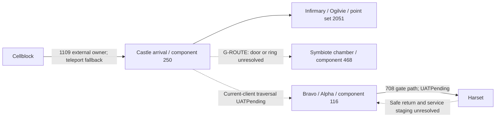

# CS-00 source reconciliation

Inspected 2026-10-14 at `d3efb7d41aad0b6008397f112d224ce7430d7acf`. This is an evidence packet for the Documentation Writer and mission/items reviewers. Exact source excerpts are in [seed-excerpts.md](seed-excerpts.md); the [contract](castle-contract.csv) separates fixed IDs from unresolved dispatch fields.

## Source classes and limits

| Class | Exact source | Recovered fact / limit |
|---|---|---|
| SHIPPED_DATA | `SGW_FINAL_DEVELOPER_HANDOFF.zip`, `WORLDS/RECOVERED/Castle/02_MISSIONS.csv`, MissionID column | Nine rows: 701, 702, 703, 704, 708, 1376, 1520, 1521, 1664. Every row says `PROVEN_MISSION_MONIKER_WORLD_EXACT`; this is a classifier relation, not runtime chronology. Extracted CSV was byte-compared with ZIP member. |
| SHIPPED_DATA | Same dossier `00_WORLD_CONTENT_DOSSIER.md` | Zero dialog/EventSet/map, Kismet/EventSet actor, runtime/world, cinematic or spawn binding rows. 105 VO and 84 audio candidates do not prove playback. Missing SQLite sources remain unavailable by owner statement. |
| RECOVERED_SCRIPT | `deprecated/python/cell/spaces/Castle.py`; `docs/analysis/castle-rebuild/audit.md` | Scope covers 701 and 702 start; a search found no 1360/567/4037/2698 bridge. Legacy server reference is not proof of client behavior. |
| RECONSTRUCTION | `docs/analysis/castle-rebuild/README.md`, Implementation Session Record; current three Castle chain seeds | 702–708 reconstructed transitions, existing gate/actors/respawners and later repairs must not be reimplemented as new restoration. |
| RECONSTRUCTION | `docs/analysis/castle-population/README.md`, population and placement tables | 24 friendly/36 hostile additions already exist; component and placement evidence predates this investigation. This packet did not rerun nav tests. |
| CLIENT_MAP | QA4046 manifest plus actual map ZIP bytes, below | Physical package identity and named assets are proved; a connected, usable player route is not. |
| CLIENT_INTERACTION_MAP | QA client `SourceCache.en-us/CookedInteractionSet.pak` and `CookedInteractions.pak`; [nine-map receipt](cooked-interaction-maps.md) | Category-8 maps 5824–5832 confirm references to sets 1571/1572 and the listed dialog IDs, but contain no dispenser/tank actor join. Category-20 generic interactions also lack the join. |
| ORAL_HISTORY | `docs/analysis/four-zone-planning/story-research.md` | Tone guidance only; no mission grant, coordinate or chronology inferred from it. |
| CIMMERIA_AUTHORING | CS-04a/b/c and CS-05 scope in planning menu | Future side stories/repeatables, not recovered 2009 content. No premise, IDs or reward grants sealed here. |

Archive SHA256: `SGW_FINAL_DEVELOPER_HANDOFF.zip` = `0317e0d4445f1c851bb60ee910fc8ea77b5661bfd589d315015dfcadc1cfb28a`.

## Old ledger versus current seed

The old CA15 row remains BlockedDecision and asks for post-704/region-2051 entry, Ogilvie binding and symbiote choice. Current spawn 197 already supplies Ogilvie/template 179; this closes the missing-Ogilvie premise, not the mission wiring. Seeds `castle_701_chains.sql`, `castle_702_704_chains.sql`, `castle_706_708_chains.sql` contain 18, 23 and 28 chains respectively. Current history includes `fff659f96` (respawner, hallway backstop, live chest/guard loot, #1031) and `41fadb306` (escort combat survival, #821). The September playtest and Downloads `castlestatus.md` describe earlier snapshots; claims of no Castle chains/population/navmesh are superseded. Existing fixes still need current-client UAT.

## 706 classifier gap

Confirmed: mission 706 exists (`missions.sql:1674`). Castle's name moniker 10635 `DN_ms_A00_Castle_opc_06BehindThrone` has empty text (`Texts/Seed/texts.sql:1428`). Its step monikers 14022/14023 and objective monikers 18227–18229 retain Castle names and throne objectives (`texts.sql:9033`, `9035`, `17596`–`17600`). The visible title also occurs at moniker 10469 `DN_Ms_A01_BetaE1_LGT_23PowerBehind` (`texts.sql:1058`).

**Hypothesis, not confirmed classifier logic:** an exact title/name join can miss 706 or select the unrelated BetaE1 title because the Castle title is blank. The CSV has no 706 row; the supplied dossier does not expose the exporter join or mission-to-name mapping/build lineage needed to prove why. G-706 holds that causal claim. Retain the existing Castle 706 reconstruction; do not remove it or move it to Beta Site from this title collision. **Status (CS-00R2, 2026-10-17): SUPPORTED** by a reproducing title-join model (an in-sample fit to nine rows); **exporter join UNRESOLVED**. Keep 706 ([g-567-706-1376.md](g-567-706-1376.md)).

## 1520 and 1521: exact data versus missing mechanics

Both mission rows are enabled. Steps 4452–4458 and objectives 5171–5178 are disabled; task rows 6372–6381 are enabled. Enabling steps alone is insufficient. The exact excerpts preserve each task/objective join.

| Mission | Dialog set / map rows | Dialogs and screens | Buttons / acceptance |
|---|---|---|---|
| 1520 | Set 1571; 5824→4982, 5825→4984, 5826→4985, 5827→4983, 5828→NULL | 4982:113564–113568; 4983:96921–96927; 4984:96928; 4985:96929–96931 | No rows in `dialog_screen_buttons.sql` for these screen IDs. `dialogs.sql` has NULL accepts_mission_id and event_set_id. Entry event remains unresolved. |
| 1521 | Set 1572; 5829→NULL, 5830→4989, 5831→4990, 5832→4991 | 4989:96950–96955; 4990:96946; 4991:96956–96958 | No button rows for these screens; NULL mission accept/EventSet fields. Do not invent button IDs. |

Speaker IDs: 1110 in medical radio exchanges, 2490 for Ogilvie, 2499 for Moh'katan, from `dialog_screens.sql:21489`–`21545`. These are speaker IDs, **not spawn/template IDs**. Spawn 197/template 179/tag `Castle_Ogilvie` at (362,70.18,886) is current reconstructed population. Map-row 5827 has flags 16777216; rows 5828/5829 have 1073741824 and NULL dialogs. Their flags do not recover when/where the server should bind them.

4984 says the dispenser now provides unlimited Ambernol; it does not prove an inventory grant. Item 19 is a historical CA15 candidate only. Items 2718 and 4652 have the same symbiote name and description, but no quest-specific grant is established by that duplication. Neither may be chosen without G-SYM. Likewise the verbs “hack” and “bypass” do not prove the SmartFox minigame type. No Castle Med Dispenser or tank actor binding was recovered from the searched spawn/template rows. The Harset tank template 245/spawn 342 is not a Castle binding.

## Map provenance and access

All **145** `.umap` members across the three supplemental archives match QA4046 `01_MAP_PACKAGES.csv` by filename and SHA256. Archive hashes:

| Archive | UMAP count | SHA256 |
|---|---:|---|
| `03_CASTLE_MAPS_01.zip` | 77 | `fa0ed209be5c0ab491a3e28521ea32266a9e432ac8b35571085df08f59275e99` |
| `03_CASTLE_MAPS_02.zip` | 34 | `bf31f65bc9cc0c69893e248d0722081ed0337327ee87d12f560fac5aa490eb7c` |
| `03_CASTLE_MAPS_03.zip` | 34 | `d96cb8ef474df5a4f492518738bd34323cf230be58d4cbde32a58566ccf761bd` |

Existing `tools/upk_parser.py::PackageReader` parsed `Castle-00090003.umap` (SHA256 `b41d2350c33c914c9be70f7e0ecd3e47e826397d3bba58d78ed0361f31605998`): name table contains `CA-SymbioteChamber00` and `CA-SymbioteChamber00_Pf0_Seq`. This proves asset presence only. `Castle-00080002.umap` matched QA hash `315384cab6cc2d7abb67eccac6593c39b8dcf267c4a6a48b49c43032af60455c`; the narrow name scan did not recover an infirmary/dispenser/ring binding. No new decoder was written.

`data/spaces/castle.nav` SHA256 is `cb499c1a5724e297d4855ef656958e01343c0facf631be9bd34084747191e9a1`. The prior population ledger places the infirmary/Ogilvie on component 250, Bravo/bunker/Alpha on 116, and chamber guards 257–259 on isolated 468. `crates/entity/tests/castle_navmesh.rs::every_castle_patrol_leg_is_routable` documents a partial-path regression when a patrol leg enters the chamber. Neither that test nor package identity proves the player's door/ring access.

The only dossier PlayerStart is build 43485 `Castle_ship.umap`, export 565, package SHA256 `b595d7bcee7233a6002c050daca3ed7cbcd88e25cd2f01e705de3eb5ff8452dc`. It is not QA4046 placement proof. DHD approach, return arrival and proposed service staging require an actual route and aggro-clearance walk; no new coordinates are allocated. Inbound-only ring region 34 must not become an invented return route.

## 1376, 1664 and carry-ins

1376's CSV moniker is `DN_ms_B00_Castle_opc_02EscortZuritskaRestart`; only step 4098 is seeded, disabled. Hold it pending lineage: the restart label does not prove a new compatible quest beside 702/704. **Status (CS-00R2, 2026-10-17): hold**, no chain; chain 1302 covers the 704 escort re-arm only; a 702-arc restart is not shown ([g-567-706-1376.md](g-567-706-1376.md)).

1664's Castle moniker is a classification, while name moniker 27315 identifies Sgt. Kaerlia with Harset. Steps 5224–5226 and objectives 6063/6059/6060/6061/6062 are fixed data. The proposed Castle acceptance/Harset debrief split is in [work-packets.md](../work-packets.md); exact grant trigger and receiving actors remain G-1664. No signature from HA-00b is asserted.

1360: Cellblock chain 1121 accepts on dialog 3995; chain 1003 grants letter 3730. The seed comment at `castle_cellblock_chains.sql:311`–`318` explicitly calls the acceptance new content and leaves 4037 active. Harset chains 6501/6502 handle 4038; no Castle advance trigger was found. G-1360 needs a source or approved reconstruction for 4037→4038. Do not confuse content-chain 1360 (completes mission 708 after `stargate_crossed Harset`) with mission 1360.

**G-1360 bounded finding (2026-10-14).** No source-supported Castle trigger for 4037→4038 was found. The Cellblock comment at `db/resources/Content/Seed/castle_cellblock_chains.sql:311`–`318` identifies the optional 1360 acceptance and explicitly leaves 4037 active; chain 1003 grants item 3730 in mission inventory (`:297`–`:298`). Treat any decision to carry or consume 3730 as `CIMMERIA_RECONSTRUCTION`, not recovered behavior. Current Harset chain 6501 is gated by mission 1360 active, step 4038 active and a disjointness check against 1361 (`db/resources/Content/Seed/harset_opcore_chains.sql:203`–`223`); it has no item-possession guard. Its `remove_item 3730` action warns and continues when the item is absent (`:235`–`:246`), so the receiver can complete 1360 without possession. Keep G-1360 **BlockedEvidence** until a source establishes the advance trigger or an explicit reconstruction is approved; do not invent the trigger. Before dispatching CS-08a, amend its test allowlist to include `crates/services/src/mission_round_trip_tests.rs` for a Cellblock→Castle→Harset persisted-mission round trip alongside the existing chain-replay/live-DB coverage; this service-level test currently falls outside the planning packet allowlist.

567: steps 2000/2012 lead to 4039 and item 2698 describes Romney's files from his Castle office. `harset_opcore_chains.sql:343`–`352` documents its missing grant and keeps recipient chains 6503/6504 disabled. The QA client's cooked map `_2817` points to set 512/dialog 2044/topic `Romney's Files`; its seed screen is Copplemann's Harset thank-you, and the disabled recipient chains use it for turn-in. [The cooked-map receipt](cooked-interaction-maps.md#romneys-files-is-a-recipient-topic) records the exact join. No Castle grant was found in current Castle chains or recovered Castle.py; exact object/drop/acquisition event remains G-567. A title/description or recipient topic is insufficient to grant a quest item.

## ID and client metadata gates

[ID census](id-census.csv) records current primary-ID counts/maxima with zero duplicates across thirteen namespaces in all `db/resources/**/Seed/*.sql` files (including multi-row INSERT tuples). Content-chain scan across all seed files found **349 unique chain IDs**, no duplicates, none in 1366–1400 or 10000–10999. The [eight committed four-zone branch snapshots](branch-snapshot.csv) all resolve to the same baseline, so their committed seed namespace is identical. This is not an atomic reservation of concurrent uncommitted work or unrelated campaigns.

No new IDs are claimed. 1366–1400 remains proposed pending owner approval and shared-table amendment; 10000–10999 is Castle's authored block but individual claims await story contracts and stock-PAK absence checks. Mission/step/objective/dialog/spawn/template/point-set/item maxima are census facts, not safe `max+1` allocations. G-ID requires coordinator reconciliation with other live ledgers immediately before dispatch.

`crates/resources/src/base/resources/apply_overrides.rs:236`–`245` skips absent mission IDs. Existing override mechanism can patch shipped entries through category-3 metadata invalidation/resource fragments; `docs/architecture/mission-pak-overrides.md` documents the path. Restored IDs do not need net-new insertion, but their exact rendered metadata still needs UAT. New authored IDs depend on CB-N05a and CS-00B; no server-only quest is a substitute.

## Explicit gates

| Gate | Owner / evidence needed | Holds |
|---|---|---|
| G-706 | Archaeology: exporter join and mission-name/build relation | **SUPPORTED (CS-00R2), exporter join UNRESOLVED**: blank Castle title reproduces the omission in-sample; existing 706 retained ([g-567-706-1376.md](g-567-706-1376.md)). |
| G-ENTRY | Coordinator + mission advisor: original event binding or approved reconstruction, exact archetype predicates and 704 prerequisite | CS-02/03 |
| G-MED | Archaeology/minigame/items: dispenser actor, verified game type, win/cancel and radio binding; inventory grant decision | CS-02 |
| G-SYM | Items/mission/minigame: 2718/4652/pouch decision, tank actor, game type and authority contract | CS-03 |
| G-ROUTE | Map/movement + authorized client walk: chamber access, DHD, return and safe service staging | CS-03/05 and route-dependent work |
| G-1664 | **BlockedDependency (HA-01b) (CS-06S)**: Castle grant frozen in [1664.md](1664.md) (trigger `mission_completed 708`, chain 1398 with a world 8 guard; chain 1399 catch-up pending a coordinator decision, it re-grants after an abandon); receiver open. HA-00b + Castle coordinator: sign proposed step division, exact acceptance event and predicates, receiver tags | CS-06 |
| G-1360 | Castle mission advisor: source or approved advance trigger for 4037→4038 | CS-08 letter leg |
| G-567 | Castle items/mission: source-backed item 2698 grant and 2000/2012 transitions | **BlockedEvidence (CS-00R2)**: no grant, transition or cabinet actor in the cooked PAKs and the 75 readable Castle packages (141 compressed packages and `SGW.exe` not checked); CS-08 files leg and Harset recipients ([g-567-706-1376.md](g-567-706-1376.md)). |
| G-ID | Owner/coordinator: restoration block approval, shared-table amendment and active-ledger collision recheck | All new chain/spawn/dialog allocations |
| G-REVIEW | Fresh mission/items review plus coordinator signature on contract rows | Runtime dispatch |

## Documentation handoff

Recommend the Documentation Writer with this packet after reviewer corrections. Preserve source-class labels and promote only resolved claims. Updates owed by later runtime packets follow `docs/agents/doc-update-map.md`: mission paths → `docs/content/mission-chains.md`; catalog changes → mission PAK override reference; UAT → `docs/guides/unified-uat.md`; shared statuses → FZ-99. Root documentation index and project-memory pointers are coordinator-owned follow-ups outside this packet's explicit allowlist. Dead ends worth retaining: duplicate title is not world ownership; identical symbiote rows are not grant proof; a QA hash match/name-table hit is not a working route; a chain ID can equal a different mission ID.
