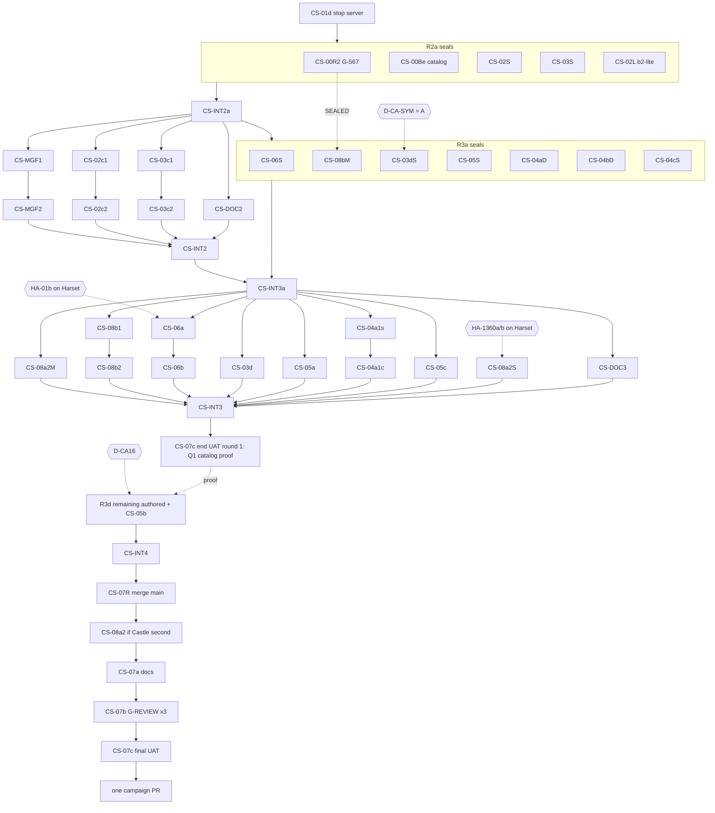

# Castle continuation: wave R3 packets, part 2 (authored, hub, closeout)

> **Type:** Reference. **Audience:** Castle orchestrator, ops, packet workers and reviewers.
> **Last updated:** 2026-10-17.
> **Companions:** [part 1: rules, contract, restoration](r3-packets.md), [R2 packets](r2-packets.md), [overlay ledger](README.md), [resume card](RESUME.md), [R3 architect report](architect-report-r3.md).

Every packet here carries the dispatch rules, the 10 repo rules, the contract excerpt and the base check from [part 1](r3-packets.md#dispatch-rules-r3). A worker reads part 1 § Dispatch rules (R3) through § Base check (R3) before its own section.

## Wave R3a continued: authored and hub seals

These are docs-only seals with the same output sections as part 1 (verdict line, frozen rows, test list, end-UAT rows). Base: the `FEATURE_SHA` after CS-INT2a. **Gate:** branch `evidence/mission-catalog.md` (CS-00Be) is integrated and names the Castle sub-blocks. If CS-00Be returned blocked, these four stay BlockedDependency (CS-00Be).

### CS-04aD: medical and prisoner stories, design seal

**Agent:** mission-systems-advisor. **Branch / worktree:** `castle/cs-04ad-medical-design` / `castle-cs-04ad`. **DB:** `sgw_castle_cs_04ad` (read-only psql only).

**Allowlist:** `docs/analysis/castle-continuation/worknotes/CS-04aD.md` (new).

**Inputs:**
- the CS-04a section of `docs/analysis/four-zone-planning/castle-work-packets.md`;
- branch `evidence/mission-catalog.md`;
- Cellblock's proven shape, read with `git show content/cellblock-campaign:docs/analysis/cellblock-continuation/worknotes/cb-n05-seal.md` (do not edit it);
- the Castle rows in `spawnlist.sql`, `entity_templates.sql`, `texts.sql` and the Dialogs seeds;
- the 1520/1521 rewards in `mission_rewards.sql`, as comparators.

Design **two or three** quests: triage supplies, the overlooked prisoner, the safe message. Under O14-10/11, a lore-safe premise, the copy and a modest reward are delegated, so no owner approval is needed.

1. **Premise.** For each quest: one paragraph, every fact it relies on cited, labelled `CIMMERIA_AUTHORING`. Name its key (`medical_q1`, `medical_q2`, `medical_q3`).
2. **Q1 is the Castle catalog-proof vehicle** (contract excerpt; D-CA8). Keep it the smallest possible surface:
   - itemless;
   - an existing friendly Castle NPC, with no new spawn;
   - one dialog and one region or interaction step;
   - a zero or modest reward;
   - the XML validator rules that `cb-n05-seal.md` proved.
3. **IDs** from the CS-00Be sub-blocks: mission, steps, objectives, tasks, dialog, screens, texts and chains (10000-10999). Run the no-collision check (part 1 contract excerpt), including Cellblock's individual claims and the stock paks. Paste the output.
4. **Frozen rows** per quest, exact and complete:
   - (a) the mission XML, as the exact bytes of a `CASTLE_<KEY>_XML` constant, with its byte count against `MAX_MISSION_XML_BYTES`;
   - (b) the `db/resources/Missions/Seed/*.sql` rows (missions, steps, objectives, tasks and rewards) that match the XML, naming each file;
   - (c) the Dialogs and text seed rows, naming each file;
   - (d) the chains, in the seed shape;
   - (e) any template or spawn, with a `nav_inspect` proof (not allowed for Q1);
   - (f) the reward numbers, with the comparator cited.
5. **Behavior** per quest: offer conditions (world 8, prerequisites), the once-only rule, relog at every step, abandon, and every refusal, each with its telemetry reason.
6. **Loader.** Name the test or loader that proves the mission seed rows load from the DB. The "s" packet's live-DB check uses it.
7. **Test lists:** split into the quest's "s" packet (catalog plus seeds) and its "c" packet (chains plus replay). Use the module name `castle_side_<key>`.
8. **End-UAT rows.** Q1's rows are the "CS-00B client proof": journal, dialog, advance and relog.

**Verdict:** one line per quest. **Commit:** `docs(castle): design-seal the medical and prisoner side stories (CS-04aD)`. **Report:** `...\castle-cs-04ad\.claude\reports\castle\CS-04aD-mission.md`.

### CS-04bD: guard-post and defense stories, design seal

This seal is the same shape as CS-04aD, with these changes:
- **Agents:** mission-systems-advisor, then npc-ai-spawn-advisor appends `## Shared actors`. **Branch / worktree:** `castle/cs-04bd-defense-design` / `castle-cs-04bd`.
- **Quests:** two or three (guard-post intelligence, prisoner safety, defense), keyed `defense_q1..q3`. None of them is the catalog proof.
- **`## Shared actors`:**
  - Credit is per player. Cite whether `entity_dead_tag` credits the killer, every witness or the group.
  - A shared actor is never despawned or retagged for one player.
  - Any new hostile meets the placement rules and respawns where it was placed.
- **Commit:** `docs(castle): design-seal the guard-post and defense side stories (CS-04bD)`. **Reports:** `CS-04bD-mission.md` and `CS-04bD-npc.md`.

### CS-04cS: return-visit stories, route and Harset contract seal

This seal is the same shape as CS-04aD, with these changes:
- **Agents:** mission-systems-advisor, then movement-teleport-advisor appends `## Return route`. **Branch / worktree:** `castle/cs-04cs-return-seal` / `castle-cs-04cs`.
- **Quests:** one or two, keyed `return_q1`, `return_q2`. Add these points before the design:
  1. **The route** (movement-teleport-advisor). Where a player arrives in world 8 from Harset: cite the stargate destination row and the arrival transform. The DHD is at `(806.27, 55.10, 517.24)`. Prove with `nav_inspect` and a path that the arrival point reaches each quest NPC on one component. The live arrival is `UATPending (end UAT)`.
  2. **The return trigger contract.** What tells Castle that the player is back after Harset: a Harset-published mission state, or a Castle-only fallback that needs no Harset change (for example `stargate_crossed` into world 8 plus `mission_status <harset mission> completed`; cite the trigger key semantics). If Harset's contract is unpublished and no Castle-only fallback exists, the verdict is `BlockedDependency (Harset return contract)`.
- **Commit:** `docs(castle): seal the return route and design the return-visit stories (CS-04cS)`. **Reports:** `CS-04cS-mission.md` and `CS-04cS-movement.md`.

**Count rule.** CS-04aD, CS-04bD and CS-04cS together must seal 5-8 quests. If they seal fewer, the architect runs a pass before R3d.

### CS-05S: return-hub services, repeatables and barks seal

**Agents, one after another:**
1. mission-systems-advisor (services placement, repeatables, barks);
2. items-systems-advisor appends `## Economy`;
3. server-authority-enforcer appends `## Authority` (repeatables and vendor sell paths only).

**Branch / worktree:** `castle/cs-05s-hub-seal` / `castle-cs-05s`. **Allowlist:** `docs/analysis/castle-continuation/worknotes/CS-05S.md` (new).

Under O14-12/13, conservative services and persisted repeatable limits are delegated, after economy and authority review.

1. **Services.** Medic and/or quartermaster, using only service mechanics the server already has (vendor, heal, repair, recharge). Cite the interaction type and the seed tables. Any new UI or general vendor behavior gives the verdict `BlockedDecision (engine packet)` for that service.
2. **The NPC and its spot.** Use an existing Castle friendly, or a new template and spawn (IDs with the no-collision check). The spot must:
   - be on the component connected to the Castle arrival and the Infirmary (`nav_inspect` exit 0, plus a path);
   - sit at least 5 u outside every aggro radius;
   - be outside every hostile respawn radius.
3. **Stock** (`## Economy`): existing item IDs only. Buy price must be at least sell-back price (no arbitrage). Cite the vendor seed rows and a comparator vendor.
4. **Repeatables (1-2).** Does the engine persist a repeat cap (`missions.num_repeats`, the `repeats` counter, `mission_round_trip_tests.rs:219`)? Does a time-based cooldown exist?
   - If only a count exists, design a count cap.
   - If a time cooldown needs a new primitive, the repeatables verdict is `BlockedEvidence (engine primitive)`, and the architect slices a CS-05E pair.
   - If a stock repeatable Castle mission exists, prefer it (restoration). Otherwise the repeatable is an authored mission keyed `repeatable_q1` and falls under D-CA16.
5. **Barks (2-4).** Only by reusing the `npc_bark` pattern (`castle_cellblock_chains.sql:2876-2877`, chains 1176-1178). Name the existing `dialog_screens` rows, the trigger and the once rule. Chain IDs come from the CS-05 sub-block.
6. **Authority:** the reward limit is per player and server-side; selling never mints currency beyond the sell rule.
7. **Test lists:**
   - CS-05a: `live_db_castle_hub`: the spawn row, its template's service type, the stock rows, and the aggro clearance.
   - CS-05b: `castle_repeatable` replay: offer, complete, re-offer, and refusal at the cap.
   - CS-05c: `castle_hub_barks` replay.
8. **End-UAT rows.**

**Verdict:** three lines (services, repeatables, barks). **Commit:** `docs(castle): seal the return-hub services, repeatables and barks (CS-05S)`. **Reports:** `CS-05S-mission.md`, `CS-05S-items.md` and `CS-05S-authority.md`.

## Authored-quest build template (CS-04xNs and CS-04xNc)

Every authored quest is built as two packet-coder packets. `<key>` is the seal's quest key, and `<seal>` is the seal worknote. The "c" packet stacks on its "s" packet's reviewed tip.

### The "s" packet: catalog entry and mission seeds

**Branch / worktree:** `castle/<pkt>-<key>-catalog` / `castle-<pkt>`. **DB:** `sgw_castle_<pkt>`. **Gate:** the seal's verdict for `<key>` is `SEALED`, and the instance table's status column is met.

**Allowlist:**
- `crates/resources/src/base/mission_additions_castle.rs` (new in the first "s" packet; later packets append one constant);
- `crates/resources/src/lib.rs`: in the first "s" packet only, `pub mod mission_additions_castle;` after `:34`;
- `crates/resources/src/base/mission_additions.rs`: the `MISSION_ADDITIONS` array only;
- `crates/resources/src/base/resources/tests/mission_additions.rs`: `:125` only. Replace `assert!(MISSION_ADDITIONS.is_empty());` with `assert_eq!(MISSION_ADDITIONS.iter().map(|a| a.mission_id).collect::<Vec<_>>(), vec![<every sealed id so far, ascending>]);`. If the enclosing test's name says "empty", rename it to `production_registry_lists_exactly_the_sealed_additions`;
- `crates/resources/src/base/resources/tests/mission_additions_castle.rs` (new in the first "s" packet), plus one `mod mission_additions_castle;` line in `tests/mod.rs` after `:16`;
- the Missions, Dialogs and text seed files the seal's point 4(b)-(c) names, with only those rows.

**Steps:**
1. Add `pub const CASTLE_<KEY>_XML: &str = r#"<exact sealed bytes>"#;` with `/// CIMMERIA_AUTHORING; frozen in <seal> (<n> bytes).`
2. Add `MissionAddition { mission_id: <id>, xml: crate::base::mission_additions_castle::CASTLE_<KEY>_XML }` to `MISSION_ADDITIONS`, in mission-ID order.
3. Copy the seed rows verbatim.

**Tests** (unit, `cimmeria-resources`, in `tests/mission_additions_castle.rs`). Use the same data-dir constant and skip guard as `tests/mission_additions.rs:141-194`.
- `castle_<key>_addition_is_admitted`: `ResourceCache::load_all_with_mission_additions(DIR, MISSION_ADDITIONS)` holds `<id>` with the sealed step, objective and task IDs. It fails if the entry is removed.
- `castle_<key>_xml_fits_and_names_its_root`: the length is at most `MAX_MISSION_XML_BYTES`, and `MissionID="<id>"` is present.
- `castle_<key>_is_new_to_the_stock_catalog`: loading with `&[]` lacks `<id>`.

**Live-DB:** the loader check the seal's point 6 names, as `live_db_castle_side_<key>_seeds`.

**Lane, in order:**
1. `cargo fmt --all -- --check`;
2. `lane.ps1 cargo clippy -p cimmeria-resources -p cimmeria-base-session --all-targets -- -D warnings`;
3. `lane.ps1 cargo nextest run -p cimmeria-resources -p cimmeria-base-session -E 'test(mission_addition) | test(cooked_sync) | test(castle_)'`;
4. `live-db-test.ps1 live_db_castle_side_<key> -p <crate the seal names>`.

**Commit:** `feat(castle): add the <key> authored mission to the catalog (<pkt>)`.

### The "c" packet: chains and replay

**Branch / worktree:** `castle/<pkt>-<key>-chains` / `castle-<pkt>`. **Base:** the "s" packet's reviewed tip.

**Allowlist:**
- `db/resources/Content/Seed/castle_side_stories_chains.sql` (new in the first "c" packet; later packets append). For a repeatable, use `castle_repeatable_chains.sql`;
- `db/database.sql`: in the first "c" packet of each file only, one `\ir` line after the last Castle include;
- `entity_templates.sql` and `spawnlist.sql`, only for rows the seal freezes;
- `chain_replay_tests/castle_side_<key>.rs` (new; a repeatable uses `castle_repeatable.rs`);
- `chain_replay_tests/mod.rs` (one line).

**Tests** (live-DB replay), using the seal's "c" list:
- the offer;
- each step advance;
- completion with the sealed reward;
- every refusal: wrong world, already active, completed, wrong step;
- relog, where sealed.

A defense quest also proves that two players are credited independently and the shared actor is never despawned. A repeatable proves the cap refusal. Each test fails if its seed row is removed.

**Lane:** `fmt`; `lane.ps1 cargo clippy -p cimmeria-cell-content -- -D warnings`; `live-db-test.ps1 castle_side_<key> -p cimmeria-cell-content` (or `castle_repeatable`). If a spawn was added, also `live-db-test.ps1 live_db_castle_population -p cimmeria-cell-catalog` and `lane.ps1 cargo nextest run -p cimmeria-entity --test castle_navmesh`.

**Commit:** `feat(castle): wire the <key> side story chains (<pkt>)`.

Reports for both packets are `...\castle-<pkt>\.claude\reports\castle\<PKT>-coder.md`.

### Instance table

| Quest key | Seal | "s" / "c" packets | Status |
|---|---|---|---|
| `medical_q1` (catalog proof) | CS-04aD | CS-04a1s / CS-04a1c | BlockedDependency (CS-04aD `SEALED` for Q1); then Ready (R3b/R3c) |
| `medical_q2`, `medical_q3` | CS-04aD | CS-04a2s/c, CS-04a3s/c | BlockedDecision (D-CA16), then BlockedEvidence (catalog proof) |
| `defense_q1`..`q3` | CS-04bD | CS-04b1s/c .. CS-04b3s/c | BlockedDecision (D-CA16), then BlockedEvidence (catalog proof) |
| `return_q1`, `return_q2` | CS-04cS | CS-04c1s/c, CS-04c2s/c | As above, plus the CS-04cS route and Harset-contract verdict |
| `repeatable_q1`, `_q2` | CS-05S | CS-05b1s/c, CS-05b2s/c | A stock mission becomes a single "c"-shape packet that is Ready once sealed. An authored one is BlockedDecision (D-CA16) |

Only the rows a seal returns `SEALED` exist. Commit subjects follow the menu: `feat(castle): add medical and prisoner side stories`, `... guard-post and defense side stories`, `... return-visit side stories`, and `feat(castle): support return-hub services and activity`. Each packet appends its key in parentheses.

## Wave R3b continued

### CS-05a: return-hub service NPC and stock

**Agent:** packet-coder. **Branch / worktree:** `castle/cs-05a-return-hub` / `castle-cs-05a`. **DB:** `sgw_castle_cs_05a`. **Gate:** CS-05S services `SEALED`.

**Allowlist:**
- `entity_templates.sql` and `spawnlist.sql` (the sealed rows only);
- the vendor or stock seed file(s) CS-05S names;
- `crates/cell-catalog/src/cell/spawner/tests/live_db_castle_hub.rs` (new);
- the spawner `tests/mod.rs` (one line).

**Test:** `live_db_castle_hub_service_is_seeded_safe_and_stocked` (live-DB). It checks:
- the spawn exists in world 8 at the sealed transform;
- the template has the sealed service type;
- every sealed stock row is present;
- no hostile aggro radius plus 5 reaches it.

It fails if any sealed row is removed. The `castle_navmesh` test covers the spot.

**Lane:** `fmt`; `lane.ps1 cargo clippy -p cimmeria-cell-catalog -p cimmeria-cell-content --all-targets -- -D warnings`; `live-db-test.ps1 live_db_castle_hub -p cimmeria-cell-catalog`; `live-db-test.ps1 live_db_castle_population -p cimmeria-cell-catalog`; `lane.ps1 cargo nextest run -p cimmeria-entity --test castle_navmesh`.

**Commit:** `feat(castle): support return-hub services and activity (CS-05a)`. **Report:** `...\castle-cs-05a\.claude\reports\castle\CS-05a-coder.md`.

### CS-04a1s: the first authored Castle quest, catalog entry

This is the template "s" packet for `medical_q1`. **Branch / worktree:** `castle/cs-04a1s-medical-q1-catalog` / `castle-cs-04a1s`. It is the first "s" packet, so it creates `mission_additions_castle.rs` and the test module.

## Wave R3c continued

- **CS-04a1c:** the template "c" packet for `medical_q1`. **Branch / worktree:** `castle/cs-04a1c-medical-q1-chains` / `castle-cs-04a1c`. It creates `castle_side_stories_chains.sql`.
- **CS-05c: barks.** **Agent:** packet-coder. **Branch / worktree:** `castle/cs-05c-hub-barks` / `castle-cs-05c`. **Gate:** CS-05S barks `SEALED`.
  - **Allowlist:** `db/resources/Content/Seed/castle_hub_barks_chains.sql` (new), one `\ir` line in `db/database.sql`, `chain_replay_tests/castle_hub_barks.rs` (new) and one `mod` line.
  - **Test:** each bark fires its one sealed screen once per player under its trigger, and not again on re-entry. Copy `chain_replay_tests/npc_bark.rs`. It fails if the chain is removed.
  - **Lane:** `fmt`, `clippy -p cimmeria-cell-content`, `live-db-test.ps1 castle_hub_barks -p cimmeria-cell-content`.
  - **Commit:** `feat(castle): add return-hub barks (CS-05c)`.
- **CS-DOC3:** **Agent:** documentation-writer. **Branch / worktree:** `castle/cs-doc3-r3-docs` / `castle-cs-doc3`. **Base:** CS-INT3a.
  - **Allowlist:** `docs/content/mission-chains.md` (the rows for 567 Castle leg, 1664, the 1521 implant, `medical_q1`, the hub and barks; only those whose seal is `SEALED`) and `docs/analysis/castle-continuation/uat/end-uat.md` (append each seal's end-UAT rows).
  - Mark tested (replay, live-DB, navmesh) against never tested (client journal, dialog, icons, barks on screen).
  - **Commit:** `docs(castle): R3 chain and end-UAT rows (CS-DOC3)`.

## CS-INT3: integrate R3b and R3c

**Agent:** packet-coder, in `zone-castle`. **Gate:** the R3c review gate.

1. Cherry-pick, in this order, each with its fixes, skipping any packet not dispatched: CS-08a2M, CS-08b1, CS-08b2, CS-06a, CS-06b, CS-03d, CS-05a, CS-04a1s, CS-04a1c, CS-05c, CS-08a2S, CS-DOC3.
2. **Conflict rule:** a conflict whose two sides are both pure additions (include lines, adjacent seed rows, `mod` lines, `MISSION_ADDITIONS` entries) keeps both, in ID order. Any other conflict means `blocked`.
3. Run, in order:
   - `pwsh tools/build-lane/reload-db.ps1`;
   - `live-db-test.ps1 'mission_567 | mission_1664 | mission_1521 | castle_side | castle_hub' -p cimmeria-cell-content`;
   - `live-db-test.ps1 'live_db_castle_hub | live_db_castle_population' -p cimmeria-cell-catalog`;
   - `live-db-test.ps1 'live_db_castle | frosts_letter' -p cimmeria-services`;
   - `lane.ps1 cargo nextest run -p cimmeria-resources -p cimmeria-base-session -p cimmeria-entity`.
4. Update the branch README rows with each SHA.

**Commit:** `chore(castle): integrate R3 restoration, hub and first authored quest`. **Report:** `...\zone-castle\.claude\reports\castle\CS-INT3-coder.md`.

## Wave R3d: the remaining authored quests (after D-CA16)

- **Gate:** D-CA16 answered. Under the recommended answer, also a passed catalog proof: Castle's `medical_q1` in the end UAT, or Cellblock's CB-N05 if the owner accepts it.
- **Waves:** fill them from the instance table, at most six packets each. "s" packets go before their "c" packets, in mission-ID order. One reviewer per wave, then **CS-INT4** (the CS-INT3 shape, with commit `chore(castle): integrate the remaining authored stories`).
- The first CS-04c "s" packet also needs the CS-04cS route verdict to be `SEALED`.

## Final phase

1. **CS-07R: bring `main` in.** **Agent:** packet-coder, in `zone-castle`. Run `git fetch origin`, then `git merge --no-ff origin/main` (the branch already merges `main`; never rebase it).
   - Conflict rule:
     - pure additions keep both sides;
     - `MISSION_ADDITIONS` and `tests/mission_additions.rs:125` keep the union of IDs, in ascending order;
     - anything else means `blocked`.
   - Then run `reload-db.ps1` and the CS-INT3 test list.
   - **Commit:** the merge commit.
2. **CS-08a2** (part 1), if the D-CA15 call says Castle merges second.
3. **CS-07a: docs closeout.** **Agent:** documentation-writer, in `zone-castle`.
   - **Allowlist:**
     - the branch `docs/analysis/castle-continuation/{README.md,RESUME.md,work-packets.md}`;
     - `docs/content/mission-chains.md` (a final check);
     - `docs/guides/unified-uat.md` (a Castle section pointing at `uat/end-uat.md`);
     - `docs/analysis/four-zone-planning/id-allocation.md` (the final Castle claims and releases in 1367-1400 and 10000-10999, plus the authored mission IDs);
     - `worknotes/CS-07.md`.
   - Walk `docs/agents/doc-update-map.md` and list the rows. **Never** edit `docs/gap-analysis*`, `docs/project-status.md` or `docs/content/zone-audit.md`. Write the FZ-99 handoff rows in `worknotes/CS-07.md`.
   - **Commit:** `docs(castle): close continuation campaign with UAT evidence`.
4. **CS-07b: G-REVIEW**, at most 3 rounds.
   - **CS-07b1** (packet-coder, `zone-castle`): run `docs/agents/pre-pr-checks.md` in full through the lane: workspace `clippy` and `nextest --profile=ci` per the `lane-build` skill, every Castle live-DB filter above, and the docs-gen check. It records results and fixes nothing. A red result returns `blocked`.
   - **CS-07b2** (read-only packet-reviewer): reviews `origin/main...content/castle-campaign` against every seal and this file.
   - Fixes go to a fresh packet-coder in `zone-castle` (`CS-07bF<n>`), then a fresh reviewer. After 3 rounds with findings left, return to the architect.
5. **CS-07c: end UAT (the user).** The orchestrator restarts the Castle server with the CS-01b recipe (D-CA13) and hands the user `uat/end-uat.md`. A documentation-writer records the results. A failed row gets an architect fix pass. Under the recommended D-CA16 answer, R3d's quests need a second, shorter UAT round.
6. **PR:** ops runs `ship.ps1 pr -C <zone-castle>`, one campaign PR (O14-06). It merges only after Harset's HA-01b is on `main` or in the same merge window (D-CA18). Otherwise CS-06a/b are reverted out of the PR first.

## R3 status

| Packet | Wave | Status | Unblocks when |
|---|---|---|---|
| CS-06S | R3a | Ready (after CS-INT2a) | - |
| CS-08bM | R3a | BlockedEvidence (G-567) | CS-00R2 returns `SEALED` |
| CS-03dS | R3a | BlockedDecision (D-CA-SYM) | The owner picks A, and CS-03S is `SEALED` |
| CS-05S, CS-04aD, CS-04bD, CS-04cS | R3a | Ready (after CS-INT2a) | CS-00Be's sub-blocks are integrated |
| CS-INT3a | gate | BlockedDependency | The R3a review |
| CS-08a2M | R3b | BlockedDependency (CS-INT3a) | none beyond the base |
| CS-08b1 | R3b | BlockedEvidence (G-567) | CS-08bM `SEALED` |
| CS-06a | R3b | BlockedDependency | CS-06S `SEALED` and the HA-01b receiver on `content/harset-campaign` (D-CA18) |
| CS-03d | R3b | BlockedDecision (D-CA-SYM) | CS-03dS `SEALED` and CS-INT2 |
| CS-05a | R3b | BlockedDependency | CS-05S services `SEALED` |
| CS-04a1s | R3b | BlockedDependency | CS-04aD `medical_q1` `SEALED` |
| CS-08b2, CS-06b, CS-04a1c | R3c | BlockedDependency | The predecessor's review |
| CS-05c | R3c | BlockedDependency | CS-05S barks `SEALED` |
| CS-08a2S | R3c | BlockedDependency (HA-1360a/b) | HA-1360a3c and b are on `content/harset-campaign` |
| CS-DOC3 | R3c | BlockedDependency | CS-INT3a |
| CS-INT3 | gate | BlockedDependency | The R3c review |
| CS-04a2..c2 (s/c), CS-05b | R3d | BlockedDecision (D-CA16) / BlockedEvidence (catalog proof) | The owner answers D-CA16, and the proof passes |
| CS-07R, CS-07a, CS-07b, CS-07c, PR | final | BlockedDependency | Every active wave is integrated |
| CS-08a2 | final | BlockedDependency (HA-1360a/b on `main`) | The D-CA15 call says Castle is second; otherwise Dropped (Harset owns) |

## Dispatch briefs (R3)

Every brief starts with: "Read `C:\Users\Steve\source\projects\Cimmeria\docs\analysis\castle-continuation\r3-packets.md` § Dispatch rules (R3) through § Base check (R3), then § <section> (in `r3-packets.md` or `r3-packets-2.md`; after CS-INT3a, use the branch copies). Follow the repo rules and the step 0 base check. `<BASE>=<sha>`. No lab."

In this table, `mk` is `pwsh tools/build-lane/mk-worktree.ps1`, and every worktree is under `C:\Users\Steve\source\projects\Cimmeria\.claude\worktrees\`. Template packets use their instance-table branch names.

| Wave | Packet | ops call | Agent | BASE |
|---|---|---|---|---|
| R3a | CS-06S | `mk castle/cs-06s-1664-seal castle-cs-06s` | mission-systems-advisor, then movement-teleport-advisor | CS-INT2a |
| R3a | CS-08bM | `mk castle/cs-08bm-567-signoff castle-cs-08bm` | items-systems-advisor, then server-authority-enforcer | CS-INT2a |
| R3a | CS-03dS | `mk castle/cs-03ds-implant-seal castle-cs-03ds` | items-systems-advisor | CS-INT2a |
| R3a | CS-05S | `mk castle/cs-05s-hub-seal castle-cs-05s` | mission, then items, then server-authority | CS-INT2a |
| R3a | CS-04aD | `mk castle/cs-04ad-medical-design castle-cs-04ad` | mission-systems-advisor | CS-INT2a |
| R3a | CS-04bD | `mk castle/cs-04bd-defense-design castle-cs-04bd` | mission-systems-advisor, then npc-ai-spawn-advisor | CS-INT2a |
| R3a | CS-04cS | `mk castle/cs-04cs-return-seal castle-cs-04cs` | mission-systems-advisor, then movement-teleport-advisor | CS-INT2a |
| gate | CS-INT3a | none (`zone-castle`) | packet-coder | branch tip |
| R3b | CS-08a2M | `mk castle/cs-08a2m-letter-tests castle-cs-08a2m` | packet-coder | CS-INT3a |
| R3b | CS-08b1 | `mk castle/cs-08b1-567-castle-leg castle-cs-08b1` | packet-coder | CS-INT3a |
| R3b | CS-06a | `mk castle/cs-06a-1664-grant castle-cs-06a` | packet-coder | CS-INT3a |
| R3b | CS-03d | `mk castle/cs-03d-implant castle-cs-03d` | packet-coder | CS-INT3a |
| R3b | CS-05a | `mk castle/cs-05a-return-hub castle-cs-05a` | packet-coder | CS-INT3a |
| R3b | CS-04a1s | `mk castle/cs-04a1s-medical-q1-catalog castle-cs-04a1s` | packet-coder | CS-INT3a |
| R3c | CS-08b2 | `mk castle/cs-08b2-567-round-trip castle-cs-08b2` | packet-coder | CS-08b1 tip |
| R3c | CS-06b | `mk castle/cs-06b-1664-round-trip castle-cs-06b` | packet-coder | CS-06a tip |
| R3c | CS-04a1c | `mk castle/cs-04a1c-medical-q1-chains castle-cs-04a1c` | packet-coder | CS-04a1s tip |
| R3c | CS-05c | `mk castle/cs-05c-hub-barks castle-cs-05c` | packet-coder | CS-INT3a |
| R3c | CS-08a2S | `mk castle/cs-08a2s-1360-interface castle-cs-08a2s` | mission-systems-advisor | CS-INT3a |
| R3c | CS-DOC3 | `mk castle/cs-doc3-r3-docs castle-cs-doc3` | documentation-writer | CS-INT3a |
| gate | CS-INT3 / CS-INT4 | none | packet-coder | branch tip |
| final | CS-07R, CS-08a2, CS-07a, CS-07b1, CS-07bF\<n\> | none (`zone-castle`) | packet-coder, documentation-writer (07a) | branch tip |
| final | CS-07b2 | none | packet-reviewer (read-only) | branch tip |

- **Report path:** `<worktree>\.claude\reports\castle\<packet>-<role>.md`.
- **Return:** `<packet> <done|blocked|failed> <sha|-> <report>`. A packet with several agents returns once per agent.
- **Review groups (D-CA6):** R3a (up to 7 seals), R3b (up to 6), R3c (up to 6) and each R3d wave each get one reviewer.
- Copy each report worth keeping to the branch `worknotes/` before the owner retires the worktree (D-CA14).

## Dependency and wave graph (R2 and R3)

If the owner picks "build before proof" for D-CA16, R3d follows CS-INT3 directly, and only one UAT round remains.
