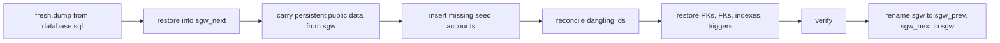

# Persistent player data: what persists, what reseeds, and why

> **Status:** Accepted (owner decisions D1-D8, 2026-10-18). The container side (wave 2) and the local refresh (wave 3) are merged; the first persistent colo deploy is the owner's UAT.
> **Scope:** which database tables survive a restart, a release and a forced reseed; the rebuild that keeps them apart; the schema-change policy. It does not teach the commands.
> **Companions:** campaign ledger [persistent-player-data/README.md](../analysis/persistent-player-data/README.md) (findings F1-F22, packets) and [OWNER-DECISIONS.md](../analysis/persistent-player-data/OWNER-DECISIONS.md); operator steps in [colo-deploy.md](../operations/colo-deploy.md); image internals in [container.md](../operations/container.md); the rules that follow from it in [rules-and-gotchas.md](../agents/rules-and-gotchas.md).

## The model in one paragraph

Game data reseeds; player data seeds once. The `resources` schema (items, worlds, missions, abilities, dialogs and the rest) is rebuilt from `db/resources/` by every new image, by a forced rebuild and by `setup.ps1 -ForceDatabase`. The `public` player tables (accounts, characters, inventory, mail, guilds, auctions) are seeded on the first load only and carried across every later rebuild. A full wipe is a separate, deliberately named action. There is no migration framework: persistent tables change additively and anything else fails closed.

## What happens when

| Event | Resources | Player data |
|---|---|---|
| First boot on an empty volume | Seeded from the baked image | Seeded from the baked image (dev and lab accounts and characters included, D1) |
| `docker restart`, crash restart, host reboot | Kept | Kept (D2) |
| New image (a release) | Rebuilt from the new seeds | Carried over; missing seed accounts inserted |
| `CIMMERIA_DB_FORCE_REBUILD=1` | Rebuilt | Carried over |
| `setup.ps1 -ForceDatabase` on a loaded `sgw` | Rebuilt | Carried over (D3) |
| `setup.ps1 -WipeDatabase` | Rebuilt | **Destroyed** (backup written first) |
| Container full wipe (`docker volume rm cimmeria-server-pgdata`, recreate, start) | Seeded | **Destroyed** |
| `reload-db`, `live-db-test`, CI loads, slot clones | Fresh load of `database.sql` into a throwaway DB, never `sgw` (D8) | Same: throwaway |

A live write to a `resources` table (the authoring console, a hand `UPDATE`) lasts only until the next resources reseed. Commit it as seed SQL under `db/resources/` ([seed-change](../../.claude/skills/seed-change/SKILL.md)). A write to a player table persists.

## Table classification

| Class | Tables | On a rebuild |
|---|---|---|
| Reseed | every `resources.*` table; `public.shards` | Replaced from the fresh DB |
| Persistent, seed top-up | `account` | Carried over; seed accounts missing by id **and** name are inserted; existing rows are never changed |
| Persistent | the other `public` tables listed in `db/persistent/persistent-public-tables.txt` | Carried over; seed rows apply on first load only |
| Rebuild-owned | `cimmeria_meta.db_state`, `cimmeria_meta.reconcile_log` | Carried over; never in `database.sql` |

`public` persists by default. The reseed exceptions are in `db/persistent/reseed-public-tables.txt`, and a type 1 lint fails when a `public` table is in neither list or both. Add a table, classify it in the same change.

## The rebuild (blue/green)

The live `sgw` is never altered in place. `public` columns use `resources` enum types, so dropping the `resources` schema would silently drop player columns, and `public` rows reference `resources` through RESTRICT foreign keys. Instead:

Any failure drops `sgw_next`, leaves `sgw` untouched and stops the container (or throws locally). A backup (`pg_dump -Fc`) is written first, newest 10 kept on the container, newest 3 locally, and `sgw_prev` stays until the next rebuild. The container runs it in POSIX sh (`docker/db-sync.sh`, `docker/db-rebuild.sh`, an s6 oneshot), the local refresh in PowerShell; both read the same SQL under `db/persistent/`. The one-time gate is the `cimmeria_meta.db_state` row, not a file.

## Decisions

| ID | Decision | Why |
|---|---|---|
| D-PP1 | Persistence is an **external** named volume `cimmeria-server-pgdata`, plus a backup bind mount. | Only an external volume survives `compose down -v`; a missing volume fails `up` instead of creating an empty DB. The name differs from setup.ps1's `cimmeria-pgdata`. |
| D-PP2 | Resources reseed by blue/green whole-DB rebuild. | The enum columns and RESTRICT FKs make an in-place schema swap unsafe; a failed rebuild leaves `sgw` untouched. |
| D-PP3 | `resources.*` reseeds; `public.*` persists by default; exceptions listed (`shards`). | The safe failure keeps player data. |
| D-PP4 | The `db_state` row gates seeding; a rebuild runs on every new image. | The row travels with the data; rebuilding every release keeps the path exercised. |
| D-PP5 | A forced reseed refreshes resources only; throwaway DBs stay full loads. | One meaning of "force" everywhere a play DB lives (owner D3). |
| D-PP6 | sh in the container, PowerShell locally, shared plain SQL. | Each side uses tools it already has. |
| D-PP7 | Persistent schema changes are **additive only**; anything else fails closed. | No migration framework; a column-named COPY needs no code for additive changes (owner D7). |
| D-PP8 | Never renumber or reuse a resource id player data references. | A reused id silently turns an item or mission into another one. |
| D-PP9 | Dangling ids: delete orphan FK-backed rows with a JSON log; relocate players in removed worlds to `Castle_CellBlock`. | Deleting with a full log is recoverable (owner D5). |
| D-PP10 | Backups on-host: newest 10 (container), newest 3 (local). | Two copies, dump and `sgw_prev`, at no cost (owner D7). |
| D-PP11 | Each layer is tested where it runs: lint, type 4 SQL smokes, a pwsh test, the container persistence smoke. | See [TESTING.md](../../TESTING.md#ci-container-image). |
| D-PP12 | Restore from a backup (`CIMMERIA_DB_RESTORE`) is disaster recovery only. | The first persistent deploy starts fresh (owner D4). |
| D-PP13 | Dependabot ignores Postgres majors. | A major bump makes the pgdata unreadable. |
| D-PP14 | The local refresh runs the container's steps in PowerShell. | Same semantics and SQL on a laptop and on colo. |
| D-PP15 | Full wipes are `-WipeDatabase` locally and the volume removal on the container; no wipe env var. | A wipe cannot hide behind a flag named "force" or "rebuild". |
| D-PP16 | Throwaway-DB scripts never target `sgw`; the main checkout uses `sgwtest`. | One live-DB run must not wipe the play DB (owner D8). |
| D-PP17 | Missing seed accounts are inserted on every rebuild; existing rows are never touched. | New dev and lab accounts reach colo with no operator step (owner D6). An operator who deletes a seed account sees it return. |

## Rules that follow

- **Additive only** on persistent tables: a new table, a nullable or defaulted column, a widened type, a new index, a new enum value. Anything else needs an owner decision and a one-off plan (D-PP7).
- **Never reuse a resource id** that a player row can reference (D-PP8).
- **A new seed character or inventory row** reaches an existing play DB only through a wipe; a new seed *account* arrives through the top-up (D-PP17).
- **Do not target `sgw`** from a script that reloads a database (D-PP16).

## Debt and open items

- A previous-image upgrade smoke in CI waits on the first persistence image.
- Off-host backups are a follow-up.
- Server tolerance of removed non-FK ids (finding F9) is audited by PP-03; see the ledger.
