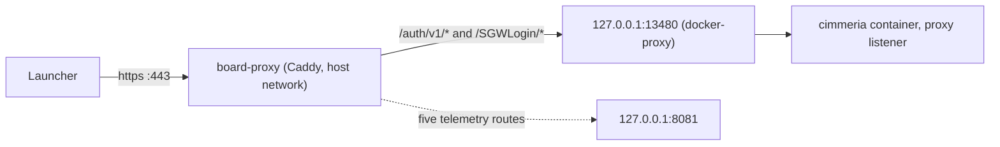

# Launcher sign-in over HTTPS (auth proxy)

> **Type:** How-to (runbook)
> **Audience:** Ops on the colo, and self-hosters running a TLS proxy next to the server
> **Last updated:** 2026-10-25
> **Companions:** [colo-deploy.md](colo-deploy.md), [telemetry-upload-endpoint.md § The colo route](telemetry-upload-endpoint.md#the-colo-route), [docker/compose.auth-proxy.yml](../../docker/compose.auth-proxy.yml), `config/auth-providers.toml.example` (on the campaign branch)

This runbook puts the launcher's sign-in on `https://play.cimmeria.app`. The board's Caddy terminates TLS and forwards two path families to the server's auth proxy listener on host loopback `127.0.0.1:13480`. Plain `8081` keeps working for unmodified clients.

## Status

| Piece | State |
|---|---|
| `docker/compose.auth-proxy.yml` overlay | In the repo. CI runs `docker compose config -q` on it and asserts that 13480 is published on `127.0.0.1` only. |
| Proxy listener code (`AUTH_PROXY_ADDR`, `proxy_layer`) | Built on the `client-tls-oidc/campaign` branch, not on `main` yet. An image without it ignores `AUTH_PROXY_ADDR`, so step 1 is harmless there but nothing answers on 13480. The same branch holds `config/auth-providers.toml.example`. |
| Caddy route (step 2) | **Not applied.** The apply packet is CT-52. |
| Anything on this page | **Never run against the colo.** Every command, status code and log line below comes from reading the code and the compose files. |

## What you are building



- Caddy forwards `/auth/v1/*` and `/SGWLogin/*` to `127.0.0.1:13480`. Every other path stays 404, apart from the five telemetry routes.
- Plain `http://play.cimmeria.app:8081` is unchanged. Its `/auth/v1` always answers `403 {"error":"https_required"}`, because that listener never reads `X-Forwarded-*`.

## Who owns what

| Piece | Owner |
|---|---|
| The overlay, `config/auth-providers.toml.example` | This repo |
| The Caddyfile | The board stack. It is host config and is in no repository until OPS-LT1 mirrors it into the private agent-board repo |
| Certificate, DNS record, 443 edge forward | Exist already for the board and the telemetry route. Nothing changes at the edge, and port 80 is untouched |

## Prerequisites

1. An image whose server logs `Auth proxy listener bound` at start (`crates/auth/src/auth/service.rs`). Check with `docker logs cimmeria 2>&1 | grep 'Auth proxy listener'` after step 1.
2. `/opt/cimmeria/config/auth-providers.toml` exists **before** `docker compose up -d`. Otherwise Docker creates an empty directory in its place. For a first start, copy `config/auth-providers.toml.example`, then:
   - delete every `[[provider]]` block and the `[links]` table (providers come in CT-53);
   - set `public_base_url = "https://play.cimmeria.app"` and `signup_open = false`;
   - run `sudo chown 1001:1001 config/auth-providers.toml && sudo chmod 0440 config/auth-providers.toml`.

   Whether a provider-less file starts cleanly on the colo is untested.
3. Fetch the overlay beside `compose.yml`: `curl -fsSL https://raw.githubusercontent.com/SandboxServers/Cimmeria/main/docker/compose.auth-proxy.yml -o compose.auth-proxy.yml`.

## Step 1: the container

```bash
cd /opt/cimmeria
sudo cp -p .env .env.bak-$(date +%Y%m%d-%H%M)
$EDITOR .env      # append :compose.auth-proxy.yml to COMPOSE_FILE
```

**Optional: narrow the trusted peers.** Do this before the `docker compose up -d` below, so the game server restarts once. Through a loopback publish the server sees the bridge gateway of the container's network, not `127.0.0.1`. The default list `127.0.0.0/8,::1,172.16.0.0/12` covers that gateway, but it also trusts the `signoz` and `otel-collector` containers, which can reach `cimmeria:13480` directly and could forge `X-Forwarded-For`. To trust the gateway alone, put it in a shell variable and append it to `.env` without printing it:

```bash
gw=$(docker network inspect signoz-net --format '{{range .IPAM.Config}}{{.Gateway}}{{end}}')
[ -n "$gw" ] && echo "AUTH_PROXY_TRUSTED_PEERS=$gw/32" | sudo tee -a .env >/dev/null
```

Never write the value into a file in the repo, a ticket or a log.

```bash
docker compose up -d
```

Use `sudo` for `docker compose` too if `.env` is root-only ([colo-deploy.md](colo-deploy.md)). This recreates `cimmeria` and restarts the game server, like a watchtower swap. Do it at a quiet time.

**Host checks:**

| Check | Expect |
|---|---|
| `ss -ltn \| grep ':13480 '` | One listener, on `127.0.0.1`. Never `0.0.0.0` or `*` |
| `curl -s -o /dev/null -w '%{http_code}\n' -H 'X-Forwarded-Proto: https' -H 'X-Forwarded-For: 192.0.2.10' http://127.0.0.1:13480/auth/v1/providers` | `200` |
| The same without `X-Forwarded-Proto` | `400` |

A `403` plus a `proxy_untrusted_peer` WARN in the server log means the narrowed list missed the peer. Remove the `AUTH_PROXY_TRUSTED_PEERS` line and run `docker compose up -d` again.

## Step 2: the Caddy route

1. Find the live file:

   ```bash
   docker inspect board-proxy --format '{{range .Mounts}}{{.Type}} {{.Source}} -> {{.Destination}}{{"\n"}}{{end}}'
   ```

   No bind mount for the Caddyfile means it is baked into the board image. Stop: only the agent-board repo can change it.
2. Back it up beside itself as `Caddyfile.bak-<date>`.
3. Add this block **inside the existing `play.cimmeria.app` site block**, before its catch-all (`handle` with no matcher, or `respond 404`). A second site block for the same host is a Caddy error.

   ```caddyfile
   	# Cimmeria launcher sign-in (client-tls-oidc CT-51): only these two path
   	# families reach the auth proxy listener; nothing else of the server does.
   	@cimmeria_auth path /auth/v1/* /SGWLogin/*
   	handle @cimmeria_auth {
   		reverse_proxy 127.0.0.1:13480
   	}
   ```

4. Write the new content **over** the old file (`cat new > live`). A single-file bind mount pins the inode, so `sed -i`, `mv` or an editor that replaces the file leaves the container on the old one. Confirm with `docker exec board-proxy grep -c cimmeria_auth <path in container>`: expect `2`.
5. Validate, then reload:

   ```bash
   docker exec board-proxy caddy validate --config <path> --adapter caddyfile
   docker exec board-proxy caddy reload --config <path> --adapter caddyfile
   ```

   If the reload is refused (admin API off), run `docker restart board-proxy`: a few seconds of board downtime.

Caddy's `reverse_proxy` sets `X-Forwarded-Proto` from its own TLS connection and appends the caller to `X-Forwarded-For`, so no `header_up` line is needed. Whether the board's global options need `trusted_proxies` is not checked.

## Checks from outside the colo network

Run these with `curl.exe` on Windows. All are expected results, not observed ones.

| Request | Expect |
|---|---|
| `GET https://play.cimmeria.app/auth/v1/providers` | Body starts `{"api":1` |
| `POST https://play.cimmeria.app/SGWLogin/UserAuth` | A SOAP status, not 404 |
| `GET https://play.cimmeria.app/admin` and `/api/config` | 404 |
| `POST {}` to `/api/auth/dev-session` | Still 422 (the telemetry route is unchanged) |
| `GET https://board.cimmeria.app/` | Still 200 |
| `GET http://play.cimmeria.app:8081/auth/v1/providers` | `403 {"error":"https_required"}` |
| Server log since the reload | No `proxy_untrusted_peer`, `proxy_missing_https_proto` or `proxy_bad_forwarded_for` |

## How the forwarded headers work

The proxy listener (`proxy_layer`) vets every request in this order:

1. The TCP peer must be in `AUTH_PROXY_TRUSTED_PEERS` (comma-separated CIDRs or bare addresses). Unset or empty means the default `127.0.0.0/8,::1,172.16.0.0/12`; a list with a bad entry trusts no peer and logs the `bad_auth_proxy_trusted_peers` ERROR, so `/auth/v1` on the proxy listener answers `403 https_required` until it is fixed. An untrusted peer has its `X-Forwarded-*` ignored and logs the `proxy_untrusted_peer` WARN, so `/auth/v1` answers `403 https_required`.
2. A trusted peer must send `X-Forwarded-Proto: https`, else `400` and `proxy_missing_https_proto`.
3. The rightmost `X-Forwarded-For` entry must parse as an IP, else `400` and `proxy_bad_forwarded_for`. It replaces the peer address for the handlers. The rightmost entry is the one Caddy appended; the leftmost is whatever the client sent.
4. The request is marked as TLS, which `/auth/v1` requires.

The peer is the bridge gateway because Docker forwards a loopback-published port through `docker-proxy`. This is the same cause as OPS-LT2 on the telemetry route. The proxy listener trusts the gateway's range by default; the telemetry quota key does not.

Provider secrets are lines in `.env` that `docker/compose.yml` forwards: `CIMMERIA_IDP_DISCORD_SECRET`, `CIMMERIA_IDP_GOOGLE_SECRET` and `CIMMERIA_IDP_OIDC_SECRET`. A provider whose `client_secret_env` is another name needs that name forwarded in `docker/compose.yml` or an override file, or the provider is skipped as `secret_missing`.

## Kill switches

Each is a line in `.env` that the overlay passes to the container; only the value `1` turns it on. Run `docker compose up -d` after you set it.

| Variable | Effect |
|---|---|
| `CIMMERIA_IDP_DISABLED=1` | Providers off: `/auth/v1` answers `503 {"error":"disabled"}` except providers and the launch-ticket routes |
| `CIMMERIA_IDP_SIGNUP_DISABLED=1` | Sign-up closed |
| `CIMMERIA_SOAP_RELAY_DISABLED=1` | `GET /auth/v1/providers` reports `soap_relay=false`, so launchers skip the SOAP relay |
| `CIMMERIA_PASSWORD_REHASH_DISABLED=1` | Planned with CT-54; not in the code yet |

## Rollback

Fastest first:

1. Restore the newest `Caddyfile.bak-*` over the live file (same inode rule), validate, reload. The two path families answer 404 again, the telemetry route and the game are untouched, and launchers stop offering sign-in at their next discovery.
2. To remove the listener too: restore `.env.bak-*` (or drop `:compose.auth-proxy.yml` and `AUTH_PROXY_TRUSTED_PEERS`), then `docker compose up -d --remove-orphans`. That restarts the game server.

Never `docker compose down -v`.

## Warning: OPS-LT1

If `board-proxy` is redeployed from the agent-board repo before the live Caddyfile is mirrored there, the redeploy removes this route and the telemetry route. The symptom is 404 on both, and launchers fall back to no sign-in.

## Self-hosters

The same overlay works behind any TLS proxy on the same host. If the server logs `proxy_untrusted_peer`, put the proxy's peer network in `AUTH_PROXY_TRUSTED_PEERS`. Or use the in-process TLS listener (`AUTH_TLS_CERT_PATH`, `AUTH_TLS_KEY_PATH`). With neither, the launcher never offers sign-in and Play works as before.
