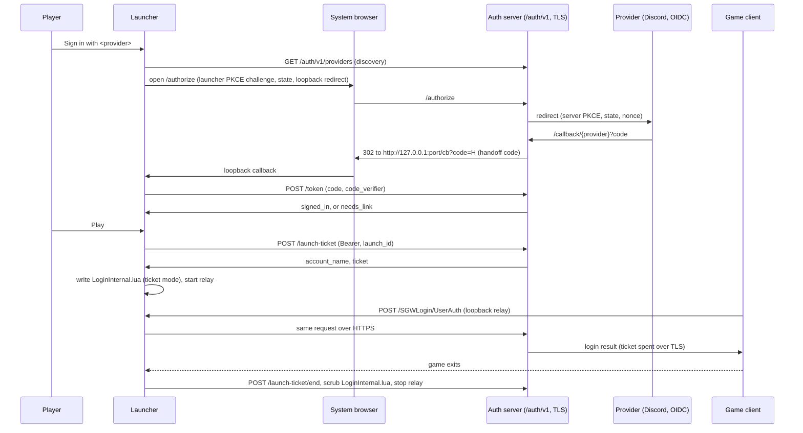

# Launcher sign-in and linked accounts

> **Type:** Explanation plus reference
> **Audience:** Engineers and operators who touch the login path
> **Last updated:** 2026-10-25
> **Companions:** [Login handshake](../protocol/login-handshake.md), [Connection flow](../connection-flow.md), [GM commands: `.account`](../commands.md), [Player guide](../client/launcher-sign-in-guide.md), [Launcher relay and ticket](../../crates/launcher/desktop/docs/sign-in.md), [Auth over HTTPS (added in a later PR)](../operations/auth-https.md)
> **Campaign record:** [client-tls-oidc ledger](../analysis/client-tls-oidc/README.md) and its [shared contract](../analysis/client-tls-oidc/contract.md). The contract holds the exact wire shapes; this page explains the flow and what you can rely on.

## Status: what runs, what has never run live

Everything below is merged code with unit and live-database tests. Three things have not been run against the real game and are not verified:

- **The client overlay in the live game** (patch `017-launcher-sign-in`): whether the stock `Login.lua` accepts the rewritten `LoginInternal.lua` and shows the signed-in screen. The ticket is pre-filled into the stock login boxes, so the player may need to press Login. Auto-submit stays off (`TICKET_AUTO_SUBMIT = false`).
- **The relay under Wine** on macOS and Linux.
- **The packaged keyring** on Windows (Credential Manager) and macOS (Keychain). The code path is covered by an in-memory store in tests; the real stores have not been exercised from a packaged build.

The live lab UAT has not happened. Treat the sections below as a description of the code, not of observed behavior.

## The flow

Step by step:

1. **Discovery.** The launcher asks the first login server for `GET https://<host>/auth/v1/providers` (4 s timeout, cached 10 minutes). No answer, or no `api: 1`, means sign-in is unavailable and the launcher behaves as before.
2. **Browser sign-in and PKCE handoff.** The launcher binds `127.0.0.1:<random>`, opens the system browser at `/authorize`, and waits up to 5 minutes. The server is a confidential OAuth client of the provider with its own PKCE and `state`. It returns a single-use 60-second handoff code to the launcher's loopback address. The launcher redeems it at `POST /token` with its PKCE verifier, so a code stolen from the redirect is useless without the verifier.
3. **`needs_link`.** If the provider identity is not bound to an account and auto-link does not apply, `/token` answers `needs_link` with a 10-minute single-use `link_grant`. The player chooses: create a new account, link an existing one with its password, or link with a GM code.
4. **Play.** The launcher mints a launch ticket for this launch, starts the loopback relay for the first login server, and writes a one-server `LoginInternal.lua` pointing at the relay. The game talks plain HTTP to `127.0.0.1`; the relay re-sends the request over HTTPS, so the ticket never crosses the network unencrypted.
5. **Heartbeat.** While the game runs, the launcher heartbeats the ticket every 10 minutes. Three failures in a row stop the heartbeats quietly; the game may already be in the world.
6. **Exit and scrub.** When the game exits, the launcher first writes the plain server list back over `LoginInternal.lua` (so no ticket stays in the install), then ends the ticket on the server, then stops the relay. If the launcher is closed while a relayed game runs, a "Game still signed in" prompt offers "Keep running" or "Close anyway".

## Linking rules

Source: `crates/identity/src/link.rs` (pure functions, C7 in the contract).

| Situation | Result |
|---|---|
| The provider identity is already bound to an account | Signed in to that account (refused with `account_disabled` if the account is disabled) |
| The provider is `trusted_email`, the email is verified, exactly one account holds a trusted verified identity with the same email, and that account is linkable | Auto-link |
| Anything else | `needs_link`, with `hint = email_match` only when a trusted, verified email matches at least one account |

A linkable account is enabled, has `accesslevel < 1` and is not a test account. Staff and test accounts cannot be linked, by any path.

**Residual risks.** The provider's email is only as trustworthy as the provider: that is why `trusted_email` is a per-provider setting and why config loading refuses `trusted_email = true` for Microsoft's consumer endpoints (the `email` claim there is mutable). A player who loses every provider has no self-service recovery; a GM issues a link code. Rate limits are in memory and reset on restart.

### No passwords on linked accounts (D-CT11)

- A linked account has no password. Linking an existing account with its password (or with a GM link code) clears the password in the same transaction as the link, and **cannot be undone**. The launcher asks the player to confirm, and the server refuses a link without `password_removal_ack: true`.
- Two database triggers (`account_password_guard`, `account_identity_password_guard`) refuse any write that would give an account both a password and an identity, whatever the path (SQLSTATE `23514`).
- Play never falls back to a password. A signed-in Play that cannot get a ticket ends as `NotStarted` with a reason shown in the panel (see Failure modes).
- The last sign-in method cannot be removed (`409 last_method`). Recovery is `.account linkcode <name>`, then "Link with a code" with a new provider.
- Removing a method needs a sign-in made by an authorization-code grant in the last 10 minutes (`reauth_required` otherwise); so does adding one.

## What stays compatible

Accounts **without** a linked identity (today the seed accounts) keep every old path, unchanged:

- Unmodified clients keep logging in over plain HTTP on the existing port.
- The legacy SHA-1 hex credential and plaintext password verification are untouched (D-CT7).
- A launcher that is not signed in, or a server with no `/auth/v1`, uses the old server list. When the server offers the relay and the player is not signed in, the relay carries the player's typed password over HTTPS (relay-password mode).

A linked account is the exception: it has no password, so an unmodified client cannot log into it. That is deliberate.

## Launch tickets

- 32 random alphanumeric characters. The client sends `SHA1HEX(ticket)` as the password field, which the existing credential classifier already treats as a legacy hash. The server stores only `SHA-256` of that hex and compares in constant time.
- One live ticket per account; minting replaces the old one. Life: 12 hours absolute, 30 minutes idle (use or heartbeat refreshes the idle clock). A reconnect or Change Server inside the life re-sends the same ticket.
- **TLS only.** A matching ticket that arrives over plain HTTP is refused with audit outcome `ticket_requires_tls` and the ticket is revoked. Successful use is audited as `launch_ticket`.
- Tickets live in server memory. A server restart clears them; the launcher has to mint a new one on the next Play.

## `/auth/v1` routes in short

All JSON, TLS only (`403 https_required` otherwise), all `Cache-Control: no-store`, all rate limited. Exact request and response shapes: [contract C6](../analysis/client-tls-oidc/contract.md).

| Route | Purpose |
|---|---|
| `GET /providers` | Discovery: `api`, `soap_relay`, `signup_open`, provider list, optional links |
| `GET /authorize`, `GET /callback/{provider}` | Browser leg; redirect URIs are loopback only |
| `POST /token` | Authorization-code or refresh grant; `signed_in` or `needs_link` |
| `POST /link/new`, `POST /link/existing` | Finish a `needs_link` |
| `POST /link/start` | Begin adding a method to a signed-in account |
| `GET /account`, `DELETE /identities/{id}` | Account view; remove a method |
| `POST /launch-ticket`, `/launch-ticket/heartbeat`, `/launch-ticket/end` | Ticket life cycle |
| `POST /logout` | Revoke a refresh token |

Access tokens last 15 minutes; refresh tokens rotate on every use and a reused one revokes its whole family. A disabled account is refused on every Bearer route.

## Kill switches and environment

Provider list: `config/auth-providers.toml` (path from `CIMMERIA_AUTH_PROVIDERS`); only `config/auth-providers.toml.example` is in git. Provider secrets come from the environment variable each provider names in `client_secret_env` (for example `CIMMERIA_IDP_DISCORD_SECRET`); a literal secret in the file is a fatal config error.

| Variable | Effect |
|---|---|
| `CIMMERIA_IDP_DISABLED=1` | No providers; every `/auth/v1` route except `providers` and `launch-ticket*` answers `503 disabled` |
| `CIMMERIA_IDP_SIGNUP_DISABLED=1` | `signup_open = false`: no new accounts, linking still works |
| `CIMMERIA_SOAP_RELAY_DISABLED=1` | `soap_relay = false`: the launcher starts no relay |
| `AUTH_TLS_CERT_PATH`, `AUTH_TLS_KEY_PATH` | In-process TLS listener |
| `AUTH_PROXY_ADDR` | Extra listener for a TLS-terminating reverse proxy; trusts `X-Forwarded-*` only from `AUTH_PROXY_TRUSTED_PEERS` (default `127.0.0.0/8,::1,172.16.0.0/12`) |

How to terminate TLS and deploy: [Auth over HTTPS (added in a later PR)](../operations/auth-https.md), [colo deploy](../operations/colo-deploy.md), [container](../operations/container.md).

## Telemetry

Spans (`crates/identity`, target `cimmeria_identity`): `auth.idp.authorize`, `auth.idp.callback`, `auth.idp.token`, `auth.idp.link`, `auth.idp.link_start`, `auth.idp.unlink`, `auth.launch_ticket.mint`, `auth.launch_ticket.heartbeat`, `auth.launch_ticket.end`. `crates/auth` emits `auth.launch_ticket.consume` where the ticket is spent. Fields are limited to `provider`, `outcome`, `reason`, `account_id` and `latency_ms`: never a code, token, ticket, subject, email, display name or IP.

The auth reaper writes one DEBUG line `Reaped expired auth entries` with the counts `expired_sessions`, `expired_tickets` and `expired_launch_tickets`, only when a count is above 0.

Launcher events: `launcher.sign_in.{started,completed,failed}` and `launcher.relay.{started,stopped}` (also `ticket_failed`, `scrub_failed`, `heartbeat_stopped`, `close_prompt`), each with outcome and reason only.

GM `.account` commands log one `gm_action` event on the `account_admin` target: `action`, `result`, a stable `reason` on refusals, and the GM and target ids. A refusal the GM caused is INFO; one the server caused (no pool, a failed query) is WARN.

Both targets (`cimmeria_identity`, `account_admin`) have a row in the [observability target catalog](../architecture/observability-target-catalog.md).

## GM recovery: `.account`

`.account identities <name>`, `.account unlink <name> <identity_id>`, `.account linkcode <name>`. GM-gated; the cell forwards to the base, which reads the identity tables (the `.bankdump` shape). Output never shows a subject or email. Full entry: [commands.md](../commands.md). A link code is 10 characters, valid 15 minutes, single use, replaces any older code for that account, and is held in process memory (a restart voids it).

## Failure modes

| What happens | What the player sees and why |
|---|---|
| Provider outage or slow provider | Sign-in fails in the browser or times out after 5 minutes; nothing is stored |
| Server unreachable at Play | Play stops, "could not get a sign-in for this launch" (`ticket_unavailable`) |
| Stored sign-in refused (`invalid_grant`, disabled account) | "Your sign-in has ended" (`sign_in_ended`); sign in again |
| Server restarted while the game ran | Tickets are in memory, so the game's next login with the old ticket fails (error 4); close the game and press Play |
| Rate limited | `429 rate_limited` with `retry_after`; shown as a wait message |
| `soap_relay` off, relay will not start, or discovery fails while signed in | Play stops (`ticket_unavailable`); it never offers a password |
| Credential store unavailable | Not exercised: the real Windows and macOS stores have not been run from a packaged build, so this failure's behavior is unverified |
